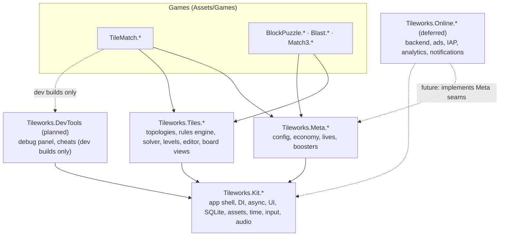
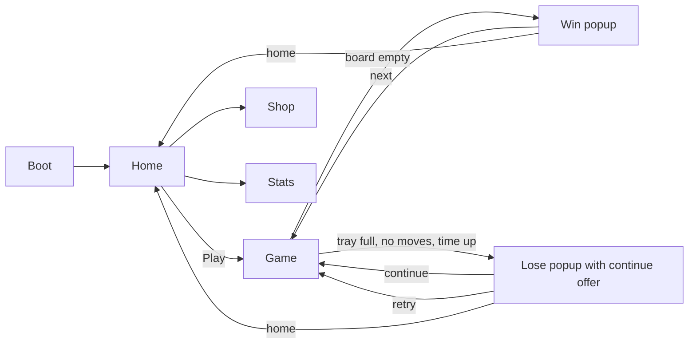
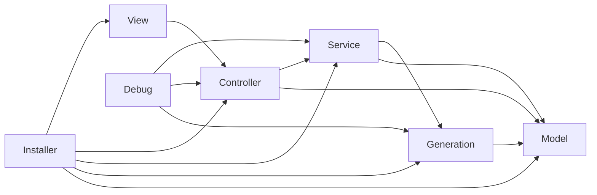
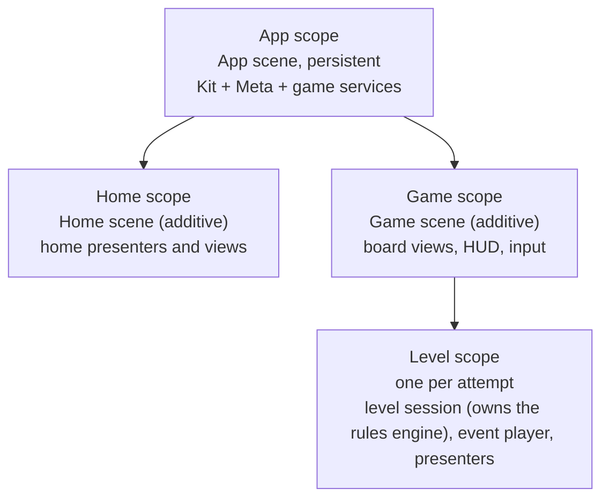
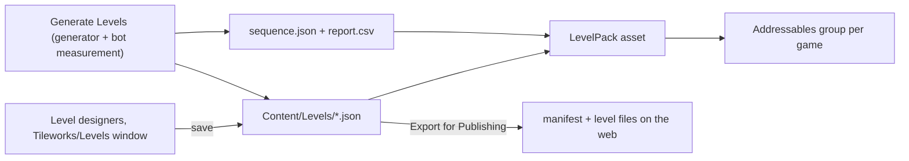

# Tileworlds: Architecture

> **Tileworks** is the framework (Kit, Tiles, Meta) and **Tileworlds** is the game and product built on it; both
> replaced the codename Tessera on 21 Oct. Tileworks appears in assembly names, namespaces, defines and menus.
>
> **Status:** design v0.2 of 15 Oct 2026, kept in step with the code since. Four games run on the framework: Tile
> Match, Block Puzzle, Blast and Gem Swap (folder `Match3`), plus the Hub that switches between them.
> **Stretch** marks work that is planned but not part of v1.
> **Must / should / may** are used in the RFC sense.
>
> **Changes from v0.1:**
> - Our own small DI container replaces Zenject.
> - Player data is stored in SQLite with data-access objects (DAOs) and per-module migrations, replacing JSON
>   files.
> - The backend, ads, purchases, analytics and notifications are deferred: they keep seams, but no implementation.
>   Live-ops is reduced to one local event (built, then removed on 22 Oct).
> - The roadmap puts gameplay, levels and a second genre first.

---

## 0. Summary

This repository contains two things:

1. **A backbone for tile-based puzzle games,** Tileworks. It ships as versioned source folders under `Assets/Tileworks` (three today, DevTools planned):
   - **Kit:** a game-agnostic foundation (app shell, our own DI container, async, UI, SQLite persistence, assets,
     audio, time, input).
   - **Meta:** the local meta-game (config, economy, lives, shared boosters).
   - **Tiles:** a framework for tile games (topologies, deterministic rules engine, undo and replay, solver, level
     pipeline, level editor, board presentation).
   - **DevTools** (planned, not present yet): in-game debug tools that are compiled out of release builds.
2. **Tile Match, the first game built on that backbone.** It is a triple-tile puzzle:
   - Tap an uncovered tile and it moves to a 7-slot tray.
   - Three tiles of the same kind in the tray clear.
   - Empty the board to win. Fill the tray without a match and you lose.
   - It adds blockers, boosters and a light meta layer.

The backbone exists so the next tile-based game can be built quickly. Block Puzzle, Blast and Gem Swap were built
that way; a sort puzzle, a word-tile game or a hex merge game would be next. Only the rules module and its views are
new. Boot, UI, persistence, meta, level pipeline, solver and editor are reused.

**Where the effort goes.** A case reviewer reads grid, level and rules code first. Most of the work goes into
Tiles, the game modules, the level editor and generator, presentation and tests. Online services are designed as
seams only (§13).



**The rules of this design:**
- Dependencies point downward only.
- Tiles depends on Kit only, so a case study can use Kit + Tiles alone.
- Games never depend on each other.

---

## 1. Goals, non-goals and quality targets

### 1.1 Goals
| # | Goal | How we know it's met |
|---|---|---|
| G1 | A polished, playable vertical slice of Tile Match | WebGL build playable on GitHub Pages; Android APK from the `Tileworks/Build` menu; 100 levels |
| G2 | A backbone for other tile-based games | Three more genres run on the same framework; architecture tests enforce independence |
| G3 | Production-grade gameplay architecture a reviewer can see | Enforced assembly boundaries, our own DI with validated scopes, deterministic rules, data-driven levels, a solver-backed generator, a level editor, clean release builds |
| G4 | Deterministic, headless-testable gameplay | Same seed and actions give the same state hash; rules tests run without scenes |
| G5 | Performance budgets that are measured, not assumed | Allocation tests in the EditMode suite; timing tests and profiler captures (planned, not built) |
| G6 | Learn the persistence pattern of top puzzle studios | SQLite with DAOs, transactions, per-module migrations and fixture-tested upgrades |

### 1.2 Non-goals (v1)
- **No online services:** backend, fake server, ads, in-app purchases, analytics, push notifications and consent.
  Each has a documented seam (§13), so it can be added without touching gameplay.
- **No live events.** A local race against bots was built and removed on 22 Oct before the first public release
  (ADR 0018). Games still report each level result through `ILevelResultListener` (§12.4), where an event would
  listen.
- **No real-time multiplayer, teams or chat.**
- **No code protection** such as obfuscation: this is open source.
- **No iOS release.** Code stays iOS-compatible; iOS is not signed or tested.

### 1.3 Quality targets
| Area | Target | Measured by |
|---|---|---|
| Frame rate | 60 fps on a mid-tier Android phone (4 GB RAM, Mali-G52 class); `AppRoot` sets 60, and 30 fps when menus are idle is planned, not built | Profiler capture per release |
| GC in gameplay | **0 B per frame** in steady state; **0 B per rules action** after warm-up | `GC.GetAllocatedBytesForCurrentThread` in tests; Profiler "GC Alloc" |
| Rules step | < 0.2 ms per action on a 300-tile level (editor, Mono) | Performance test (planned, not built) |
| Solver | Validates any shipped level in < 2 s (editor), with a node budget | The solver check in `Tileworks/Tile Match/Generate Levels` |
| Save commit | < 2 ms for a level-end transaction on the reference device | Commit time in the log (`LevelResultCommitter`); a background writer is added only if exceeded |
| DI | App scope build + validation < 30 ms; no resolves per frame | Boot timings logged by `BootPipeline`; only installers see the container (§6.7) |
| Boot to Home | < 2.5 s warm start; < 5 s cold | Boot pipeline timings logged |
| Level load | < 400 ms from tap to first frame of the board | Profiler capture |
| Draw calls | ≤ 25 in gameplay (one atlas for board tiles) | Frame Debugger capture |
| Memory | < 300 MB resident on Android | Memory Profiler snapshot |
| WebGL download | < 30 MB compressed | Build report (`Artifacts/build-*.txt`) |
| Incremental compile | < 8 s after editing one View-layer file | Editor compile log |
| File size | No source file > 400 lines | `SourceFiles_StayUnderSizeBudget` (§6.7) |

---

## 2. Tile Match: the game spec for engineers

### 2.1 Core loop
1. Home → Play → the board appears. (Picking pre-level boosters is planned, not built.)
2. Tap a **free** tile, one that no higher tile overlaps. It flies into the **tray**, next to any tiles of the same
   kind already there.
3. **Three of a kind** in the tray clear. Tiles beneath the removed tile may become free.
4. **Win:** the board and tray are empty. **Lose:** the tray is full and no triple can form, no tile can be selected,
   or the timer runs out.
5. On a loss, a continue is offered for coins: +1 tray slot and the last 3 tray tiles return to the board.
   Up to 2 continues per attempt (`ContinueConfig`). Declining ends the attempt and costs a life.
6. A win gives coins.

### 2.2 Precise rules
- **Positions.** Tiles sit on a half-unit grid in layers.
  - A tile occupies a 2×2 half-unit footprint at `(x, y)` on layer `l`.
  - Tile A **covers** tile B when `A.l > B.l` and `|A.x − B.x| < 2` and `|A.y − B.y| < 2`.
  - A tile is **free** when no tile still on the board covers it and no modifier forbids selecting it.
- **Tray.** Its capacity `C` comes from the level (default 7).
  - A selected tile is inserted directly after the last tray tile of the same kind. If there is none, it goes at the
    end.
  - Tray order is part of the model, so the display is deterministic.
- **Clear.** After each insertion, if a kind has 3 tiles in the tray, those 3 are removed and the rest shift left.
  - At most one triple can form per insertion. A group selection, such as a linked pair, inserts one tile at a time
    and checks after each.
- **End conditions,** checked after resolution:
  - Won when no tiles are on the board, in the tray or in spawners.
  - Lost when the tray count equals `C`. Clearing runs before this check, so a 7th tile that completes a triple
    does not lose.
  - Lost when no tile on the board can be selected (`NoMoves`).
- **Tile counts.** For every kind, the total across board, spawners and hidden tiles is a multiple of 3. The level
  validator (`TileMatchLevelBuilder`) rejects any level that breaks this.
- **Optional timer.** Time is not a rules input. The level session submits a `TimeUp` action when the timer runs out
  (§10.3), which keeps the rules deterministic.

### 2.3 Blockers (modifiers)
Each is a plug-in (§10.6), so the core rules never mention them.

| Modifier | Behaviour | Data |
|---|---|---|
| **Frozen** | Can't be selected while it has ice. Each triple cleared anywhere removes one ice layer. | `layers: 1–3` |
| **Hidden** | Shows its back until it becomes free, then reveals its kind. | — |
| **Linked** | Two tiles chained together. Selecting either one moves both into the tray. | `partner: tileIndex` |
| **Spawner** | A stack position that pushes the next queued tile onto the board when its top tile leaves. | `queue: [kind…]` |
| **Lock & Key** (Stretch) | A locked tile becomes selectable after the key tile's triple clears. | `key: tileIndex` |

### 2.4 Boosters
| Booster | Effect | Implementation |
|---|---|---|
| **Undo** | Returns the most recent selection still in the tray to its board position (a linked pair returns together) | A rules action (`UseBooster(Undo)`), not a snapshot restore, so it emits events the view can animate |
| **Magnet** | Completes a triple: picks the kind with the most tiles in the tray (ties go to the kind whose missing tiles are least buried) and pulls the missing tiles from the board, even covered ones, but never locked, hidden or linked ones | Rules action (`MagnetBooster`) |
| **Shuffle** | Reassigns kinds among the visible tiles on the board and keeps the count per kind | Rules action using the RNG's shuffle stream (`TileMatchRules.ShuffleStream`) |
| **Extra slot** | +1 tray capacity for this attempt (max +2) | Rules action |

Boosters are economy resources (§12.2). Spending happens in the level session, before the rules action is applied.
The rules never know about the economy.

### 2.5 Meta (v1, all local)
- **Resources:** coins, lives (max 5, one regenerates every 30 min, with windows of infinite lives) and a count for
  each booster.
- **Home screen:**
  - **top bar:** lives and timer, coins
  - **Play button:** shows the next level number, on a level path; a difficulty label (Hard / Super Hard) is planned,
    not built
  - **buttons:** Shop, Stats and game switching
- **Shop (coins only):** booster bundles and a lives refill. There are no real-money purchases in v1.
- **Stats screen:** reads the `level_attempts` table (`StatsService`: attempts, wins and win rate, current and best
  win streak, the most recent attempts). It shows what SQLite gives us and helps with tuning.

### 2.6 Live events
None in v1 (§1.2). Daily streak and milestones are Stretch.

### 2.7 Screen flow

*(Planned, not built.)* When the player returns to Home, the **Home action queue** (§11.6.4) plays any pending items
in priority order:
- level reward fly-ins
- reward chests (§12.3)

### 2.8 Content plan (v1)
- 100 layouts, written from shape recipes by `Tools/make_layouts.py`; hand-authored ones carry an `H` prefix.
- Kinds are assigned by the generator (§10.8) and checked by the solver.
- Difficulty is labelled per level.
- A difficulty curve with a Hard level every 5 from level 10 and a "Super Hard" level every 20 from level 40.

---

## 3. Principles

1. **Platform first, game second.** Anything that isn't specific to one genre belongs in the framework, and the game
   is a thin module on top. Code moves into the framework only when any single game copied into another project would
   need it, not merely because a second demo game does (ADR 0025).
2. **Features are split by layer.** Every feature uses the same layer vocabulary (Api, Model, Generation, Service,
   Controller, View, Installer, Debug, Editor, Tests), and each layer is its own assembly with fixed reference rules. A layer exists only
   when it has code.
3. **Rules are plain C#.** Game rules, models and configs live in assemblies with `noEngineReferences: true`. They
   are deterministic, allocation-free after warm-up, and testable without scenes.
4. **The logic runs ahead of the view.** Rules apply immediately and emit events. The view plays those events back on
   its own clock and never reads live model state for animation.
5. **Composition happens only in Installer assemblies.**
   - Plain classes take their dependencies through one public constructor, with no attributes.
   - Views are passive; nothing injects into MonoBehaviours.
   - Only installers and the scope runner know the container exists.
6. **Every async operation has an owner.** Each operation runs under a cancellation token from a scope (app, scene,
   level, popup). There are no `async void` methods and no fire-and-forget calls without an error sink.
7. **No hidden global state.** No singletons and no static mutable fields outside an allow-list, enforced by a test.
   This keeps "Enter Play Mode without domain reload" safe.
8. **Data drives content, policy and tuning.** Levels, booster unlocks, continue prices and game-feel timings
   are data with validation and safe defaults.
9. **Commands change things; messages report facts.** Call another module through its `Api` interface to change
   something. Publish a message to say something happened. Never the reverse.
10. **Write seams now, online later.** Anything a server would own goes behind an interface whose v1 implementation
    is local: time source, economy authority, config source.
11. **Release builds contain only release code.** Debug, cheat, test and editor code is compiled out with define
    constraints, and no test-only dependency ever ships.
12. **Budgets are tests.** Allocation, assembly-graph, composition and file-size budgets fail the EditMode suite
    instead of living in a wiki; performance tests are planned, not built.
13. **Prefer boring technology, and build what we want to understand.** Use mature, free libraries for
    commodities (async, tweening, SQLite binding). Build the parts that show architecture ourselves: the container,
    rules engine, event player and UI framework. Code dependencies go through the package manifest; third-party art,
    audio and fonts live in `Assets/ThirdParty/<Vendor>`.
14. **Every non-obvious decision gets an ADR** (§24). A reviewer should be able to see the reasoning, not only the
    result.

---

## 4. Technology stack

| Area | Choice | Why | Rejected |
|---|---|---|---|
| Engine | **Unity 6.3 LTS** (6000.3.x), pinned in `ProjectVersion.txt` | Current LTS, supported until Dec 2027 | 2022.3 (out of standard support); non-LTS 6.x (short support window) |
| Render | URP with the 2D Renderer, SpriteAtlas v2 | Batching, a single material for tiles, simple lighting for VFX | Built-in pipeline (legacy) |
| DI | **Our own container**, `Tileworks.Kit.Injection` (§7) | Small and explicit: constructor injection, child scopes, lifecycle, validated graphs. Building it shows understanding, and it fits our scope tree exactly | VContainer (the fallback: same constructor style, so migration is cheap); Zenject (largely unmaintained) |
| Async | **UniTask** | Zero-allocation awaits, PlayerLoop integration, cancellation helpers, WebGL-safe | `Awaitable` (thinner tooling, fewer combinators); coroutines (no return values or cancellation) |
| Tweening | **PrimeTween** | Zero-allocation tweens and sequences; awaitable | DOTween (allocates; DLL distribution) |
| Player data | **SQLite** via `com.gilzoide.sqlite-net` (MIT, OpenUPM) | Transactions across features, DAOs, real migrations; supports Android, iOS and WebGL | JSON files (no cross-file atomicity); PlayerPrefs (no transactions; platform limits) |
| Authored content | JSON via Newtonsoft (`com.unity.nuget.newtonsoft-json`) | Levels and config must diff and review well; `JObject` payload migrations | Content in SQLite (unreadable diffs) |
| UI | uGUI + TextMeshPro for game UI; UI Toolkit for editor tools and the runtime debug panel | uGUI is artist-friendly with a mature mobile workflow; UI Toolkit is ideal for tools | UI Toolkit for game UI (animation and effects tooling is weaker for juicy mobile UI) |
| Input | Input System through the uGUI EventSystem; gestures come from a full-screen `PointerSurface` | Unified touch and mouse; one target per press, so UI and board never both react; testable via `InputTestFixture` | Legacy Input Manager |
| Content loading | Addressables (local groups, remote-ready) | Ownership-scoped loading, future content updates | Resources folder (no memory control) |
| Localization (planned, not built) | Unity Localization (`com.unity.localization`) | Free, string tables, smart strings, pseudo-locale | Paid assets (can't be committed to a public repo) |
| Text formatting (planned, not built) | ZString (OpenUPM) | Zero-allocation string building for HUD counters and logs | `string.Format` in hot paths |
| Tests | Unity Test Framework, Performance Testing package, hand-written fakes | Fakes are clearer; no mocking library needed | Mocking libraries in runtime assemblies |
| Analyzers | `.editorconfig`; `Microsoft.Unity.Analyzers` is planned, not built | Catches Unity-specific mistakes | — |
| CI (planned, not built) | GitHub Actions + GameCI (`unity-test-runner`, `unity-builder`) | Standard, free for public repos | — |

**How dependencies are installed.**
- Code goes in through `Packages/manifest.json`, using OpenUPM scoped registries or git URLs pinned to tags.
- No third-party source or DLLs are committed, and no paid assets are used. Free third-party art, audio and fonts
  (CC0 and OFL) live in `Assets/ThirdParty/<Vendor>`.
- Anyone can clone and build.

---

## 5. Repository layout

The repository root is the Unity project. A single project hosts every game, and `BuildScript`
(`Assets/Settings/Editor`) picks each build's game: its entry scene, Addressables groups, product name, bundle id and
defines. The showcase build packs every game behind the Hub. This proves the framework doesn't depend on any one game.

```
Tileworlds/
├─ ARCHITECTURE.md          ← this file
├─ README.md                ← GIF, play link, diagram, how to run, decisions index
├─ TODO.md  .editorconfig  .gitignore  .gitattributes (LFS rules for art/audio); LICENSE planned
├─ docs/
│  ├─ adr/                  ← ADR-0001 … (§24)
│  ├─ *.md                  ← decisions log, level design, web build, remote levels, design notes per game
│  └─ playbooks/            ← "add a modifier", "add a table", "new game from template" (planned, not built)
├─ Tools/                   ← batch-mode runner (unity.sh), art and audio
│                             scripts, layout writer, web deploy and level publishing
├─ Packages/
│  └─ manifest.json         ← third-party packages only
└─ Assets/
   ├─ Tileworks/            ← the framework, one source folder per tier
   │  ├─ Kit/               Runtime/ · Editor/ · Tests/
   │  ├─ Meta/
   │  ├─ Tiles/
   │  └─ DevTools/          (planned, not present yet)
   ├─ Settings/             ← URP assets; Editor/ holds BuildScript and the content setup
   ├─ AddressableAssetsData/  ← Addressables settings and groups
   ├─ Tests/Architecture/   ← the architecture tests (§6.7)
   ├─ ThirdParty/           ← third-party art, audio and fonts, one folder per vendor
   ├─ WebGLTemplates/       ← the WebGL page
   └─ Games/
      ├─ TileMatch/
      │  ├─ Api/ Model/ Generation/ Service/ Controller/ View/ Installer/ Editor/ Tests/   (one asmdef each)
      │  ├─ Content/        ← Layouts/*.txt, Levels/*.json (one file per level), sequence.json, report.csv, LevelPack
      │  ├─ Config/         ← generated assets: GameFeel, TileSkin, TileSounds, the app installer; config.json
      │  ├─ Art/            ← game art (shared third-party assets are in Assets/ThirdParty; see §15 about licences)
      │  └─ Prefabs/ Scenes/ (App, Home, Game)
      ├─ BlockPuzzle/  Blast/  Match3/   ← the other three games, same layer folders
      ├─ Hub/               ← the game switcher shown first in the showcase build
      └─ Shared/            ← Editor scene and UI builders, shared art, audio, fonts and the game catalog
```

Each tier folder has the same internal shape, and no `package.json`:
```
Assets/Tileworks/<Tier>/
├─ Runtime/<Module>/       one folder per assembly: Tileworks.<Tier>.<Module>.asmdef
├─ Editor/                 editor-only assemblies
└─ Tests/Editor/           test assemblies (never auto-referenced)
```

**Using the framework in another project,** for example in a studio case study: copy `Assets/Tileworks/Kit` and the
tiers you need (Tiles needs Kit, Meta needs Kit) into that project's `Assets/Tileworks/`, and add the third-party
packages Kit lists in §6.1 to its manifest. The framework travels as a source folder, never as a UPM dependency, so
reviewers can read and diff it like the rest of the project. Tagging each tier separately (`kit/1.2.0`) so a copy
names the version it came from is planned, not built: there are no tags or workflows yet.

---

## 6. Tiers, assemblies and dependency rules

### 6.1 Tiers
| Tier | Folder | Contents | May reference |
|---|---|---|---|
| Kit | `Assets/Tileworks/Kit` | Engine-level foundation: no game, economy or backend concepts | Unity, UniTask, PrimeTween, Newtonsoft, Addressables (Content.Addressables only), sqlite-net (Save only) |
| Meta | `Assets/Tileworks/Meta` | Config, economy, lives, shared boosters | Kit |
| Tiles | `Assets/Tileworks/Tiles` | Tile-game framework | Kit **only** |
| DevTools | `Assets/Tileworks/DevTools` (planned, not present yet) | Debug panel, cheats framework, SQL console | Kit |
| Game | `Assets/Games/<Game>` | One game, or the Hub | All of the above; never another game |
| Project | `Assets/Games/Shared`, `Assets/Settings`, `Assets/Tests` | Scene and UI builders shared by the games, build scripts, architecture tests (`Tileworlds.*`) | Anything; nothing at runtime depends on it |
| *(Online, deferred)* | `Assets/Tileworks/Online` | Backend client, ads, IAP, analytics, notifications (§13) | Kit, Meta (implements Meta seams) |

### 6.2 Feature × layer
Each feature assembly is named `<Root>.<Feature>.<Layer>`, for example `Tileworks.Meta.Boosters.Service` or
`TileMatch.View`.

| Layer | Contains | Engine refs | Notes |
|---|---|---|---|
| **Api** | Interfaces, messages and value types other features may use | none | Optional. The only assembly other features can reference. |
| **Model** | Data, validated configs, state, pure rules | **none** (`noEngineReferences`) | Deterministic and allocation-aware |
| **Generation** | Level generators and difficulty measurement, used by Editor tools and tests | **none** (`noEngineReferences`) | May reference Api and Model |
| **Service** | Long-lived feature logic (`…Service`, which implements `Api`); persistence (`…Dao`, entities, schema module) | yes | No UI types. The only layer that touches SQLite. |
| **Controller** | Presenters and flows for screens and popups, plus the view interfaces (`IHudView`) | yes (no `UnityEngine.UI`) | Talks to views only through interfaces |
| **View** | MonoBehaviours implementing the view interfaces; prefab scripts | yes | Passive: no services, no container |
| **Installer** | Registrations: the composition root of the feature | yes | The only layer that sees every other layer and the container |
| **Debug** | Debug-panel sections and cheats; none exist today | yes | `defineConstraints: ["TILEWORKS_DEV"]` |
| **Editor** | Inspectors, tools, codegen | Editor | `includePlatforms: ["Editor"]` |
| **Tests** | EditMode/PlayMode tests | any | `defineConstraints: ["UNITY_INCLUDE_TESTS"]` |
| *(Network, Server)* | *DTOs, commands and fake endpoints, reserved for online features (§13)* | none | *Not used in v1* |

### 6.3 Reference matrix (within a feature)
✓ = allowed. Anything not listed is forbidden. Every layer may also reference lower tiers.

| from ↓ / to → | Api | Model | Generation | Service | Controller | View | Installer |
|---|---|---|---|---|---|---|---|
| Model | ✓ | — | | | | | |
| Generation | ✓ | ✓ | — | | | | |
| Service | ✓ | ✓ | ✓ | — | | | |
| Controller | ✓ | ✓ | | ✓ | — | | |
| View | ✓ | ✓ | | | ✓ | — | |
| Installer | ✓ | ✓ | ✓ | ✓ | ✓ | ✓ | — |
| Debug | ✓ | ✓ | ✓ | ✓ | ✓ | | |

Rules across features:
- A feature may reference another feature's **Api** only (Installers, tests and Editor code excepted).
- A feature never references a feature's Service or View directly.
- A game's Api, Model, Service and Generation never reference a `*.View` assembly, not even a lower tier's. Contracts
  that logic and views share live in Model: `IEventPlayer` is in `Tileworks.Tiles.Model`.
- Shared UI widgets live in `Tileworks.Kit.UI`; shared board widgets such as the booster bar live in
  `Tileworks.Tiles.View`.



### 6.4 Api/implementation split
A feature that others call gets a tiny `*.Api` assembly. For example, `TileMatch.Api` holds `ILevelProgress`, and
`Tileworks.Meta.Api` holds `IEconomy` and `ILives`. This has three effects:
1. **Faster builds.** Changing the implementation recompiles only that feature and the composition root.
2. **No accidental coupling.** Consumers can't reach implementation types.
3. **Easy fakes.** Tests can provide fakes (and DevTools, once built).

### 6.5 Naming
- **Assemblies, folders and root namespaces match:** `Tileworks.Kit.UI` lives in `Runtime/UI/` with namespace
  `Tileworks.Kit.UI`.
- **Games use their own root:** `TileMatch.*`, `BlockPuzzle.*`, `Blast.*`, `Match3.*`, `Hub.*`, not `Tileworks.*`.
  Project-level code uses `Tileworlds.*` (`Tileworlds.ArchitectureTests`, `Tileworlds.Games.Editor`,
  `Tileworlds.Project.Editor`).
- **Every assembly has `autoReferenced: false`.** Nothing in `Assembly-CSharp`.

### 6.6 Example asmdef (Model layer)
```json
{
  "name": "TileMatch.Model",
  "rootNamespace": "TileMatch.Model",
  "references": ["Tileworks.Kit.Core", "Tileworks.Tiles.Model", "Tileworks.Tiles.Search", "Tileworks.Tiles.Levels"],
  "noEngineReferences": true,
  "autoReferenced": false,
  "overrideReferences": true,
  "precompiledReferences": ["Newtonsoft.Json.dll"]
}
```

### 6.7 Enforcement
The EditMode assembly `Tileworlds.ArchitectureTests` (`Assets/Tests/Architecture`) runs with the other EditMode
tests. `AssemblyCatalog` reads every `.asmdef` under `Assets/Tileworks` and `Assets/Games`, and `ArchitectureTests`
checks:
1. Tier rules (§6.1) and the layer matrix (§6.3), based on assembly names
   (`TierRules_DependenciesPointDownward_AndGamesAreIndependent`, `LayerMatrix_IsRespectedWithinAFeature_AndOnlyApiAcrossFeatures`).
2. `*.Model`, `*.Api`, `*.Generation`, `Tileworks.Kit.Core`, `Tileworks.Kit.Injection`, `Tileworks.Tiles.Model` and
   `Tileworks.Tiles.Search` have `noEngineReferences: true`.
3. `*.Debug` and `Tileworks.DevTools` have the `TILEWORKS_DEV` define constraint. `*.Tests` have `UNITY_INCLUDE_TESTS`.
   `*.Editor` assemblies are Editor-only, and every assembly sets `autoReferenced: false`.
4. No framework assembly references `Assets/Games/**`. No game references another game.
5. **Only `*.Installer` and `Tileworks.Kit.App` reference `Tileworks.Kit.Injection`** (`ContainerBuilder`,
   `IResolver`); tests and Editor code are exempt. Using `IResolver` anywhere else would be a service locator and fails
   the test.
6. **Only `*.Service` and `Tileworks.Kit.Save` reference sqlite-net. Only `Tileworks.Kit.Content.Addressables` and
   `*.Installer` reference Addressables.**
7. **A game's Api, Model, Service and Generation reference no assembly ending in `.View`**
   (`GameLogicLayers_ReferenceNoViewAssembly`). The layer matrix only checks within one feature prefix, and the tier
   rule lets a game reference all of Tiles, so without this rule a Service could reach `Tileworks.Tiles.View`.
8. Using reflection over the loaded assemblies:
   - no static mutable fields unless marked `[AllowStaticState("reason")]`
   - no public fields on MonoBehaviours
   - every non-abstract class in Service and Controller assemblies has at most one public constructor
   - every MonoBehaviour and ScriptableObject lives in a file named after it
9. Banned APIs, checked by `BannedApis_AreNotUsed` over every runtime source file:
   - `FindObjectOfType`, `FindObjectsByType`, `FindAnyObjectByType`, `FindFirstObjectByType`
   - `GameObject.Find`, `SendMessage`
   - `Resources.Load` (except in `Tileworks.Kit.App` boot)
   - `async void`
   - `UnityEngine.Random` and `Random.Range` outside View and Debug assemblies (use `Pcg32`)
   - `DateTime.Now` (use `IClock`)
   - `PlayerPrefs`
   - raw SQL string concatenation (`"… WHERE " +`): parameters only
10. At most 80 runtime assemblies (`RuntimeAssemblies_StayWithinBudget`), and no source file over 400 lines
    (`SourceFiles_StayUnderSizeBudget`). The size rule covers every assembly under `Assets/Games`, `Shared` included,
    although `Shared` is Project tier for the layer rules.

### 6.8 Assembly budget
- There are 54 runtime assemblies today: Kit 12, Meta 5, Tiles 6, 7 for each of the four games and 3 for the Hub.
- The ceiling is 80 (`RuntimeAssemblies_StayWithinBudget`). Recording clean and incremental compile times and failing
  a build on a regression of more than 20% is planned, not built.
- Merge any layer that holds fewer than ~3 files into its neighbour, with an ADR.

---

## 7. Dependency injection: our own container (`Tileworks.Kit.Injection`)

### 7.1 Why our own
- **Industry practice is split.** Some large mobile studios use off-the-shelf containers. Others build their own
  container or context system, often with constructor injection and child scopes per context.
- **Most of what makes DI libraries large isn't needed here,** because our design already avoids it:
  - no attributes
  - no field or property injection
  - no injection into MonoBehaviours (views are passive)
  - no scene scanning
- **What's left is small** (~800 lines): registration, constructor injection, child scopes, lifecycle, collections,
  factories and validation.
- **A reviewer can read it,** and it is tested like any other code.
- **The fallback is VContainer.** Plain classes already use the constructor style VContainer resolves, so migrating
  would only rewrite installers and the scope runner (ADR-0002).

### 7.2 API
```csharp
public enum Lifetime { Single, Transient }       // Single = one instance per registering scope

public sealed class ContainerBuilder
{
    public Registration Register<TImpl>(Lifetime lifetime) where TImpl : class;
    public Registration RegisterInstance<T>(T instance) where T : class;
    public Registration RegisterFactory<T>(Func<IResolver, T> create, Lifetime lifetime) where T : class;
    public Registration RegisterEntryPoint<TImpl>() where TImpl : class;  // Single, created at scope start
    public Scope Build(string name, Scope parent = null);           // validates, then returns a scope
}

public sealed class Registration                 // fluent
{
    public Registration As<TService>();
    public Registration AsSelf();
    public Registration AsImplementedInterfaces();
    public Registration Owned();                 // the scope disposes a registered instance
}

public interface IResolver                       // only installers, factories and the scope runner see this
{
    T Resolve<T>();
    bool TryResolve<T>(out T value);
    object Resolve(Type type);
}

public sealed class Scope : IResolver, IDisposable
{
    public string Name { get; }
    public string Path { get; }                  // "App/Game/Level"
    public Scope Parent { get; }
    public Scope CreateChild(string name, Action<ContainerBuilder> configure);
    public UniTask StartAsync(CancellationToken ct);   // creates entry points, runs lifecycle in order
    public void Dispose();                              // children first, then own instances in reverse creation order
}
```

### 7.3 Resolution rules
- **Constructors.** A class must have exactly one public constructor; the architecture test enforces it. Its
  parameters are resolved in this order:
  1. Registrations in the current scope.
  2. Registrations in its parent, then the parent's parent, and so on.
  3. **Collections:** `IReadOnlyList<T>` gathers every registration of `T` from this scope and its ancestors, nearest
     first, then in registration order. Contributors use this (`IBootStep`, `ISchemaModule`, `IAppState`,
     `ILevelResultListener`).
  4. Factories, through `RegisterFactory`. Business code depends on a small factory interface
     (`ILevelContextFactory`), never on `IResolver`.
- **Activation.** Constructor metadata is read once per type with reflection and cached as a parameter plan.
  - Instances are created with `ConstructorInfo.Invoke`, which works under IL2CPP and AOT.
  - Resolving happens only while building or starting a scope, never per frame.
- **IL2CPP stripping.** `PreserveOwnCode` (an `IUnityLinkerProcessor`) keeps our own assemblies and sqlite-net whole
  at build time, so constructors found by reflection survive stripping.
- **Ownership.**
  - A scope disposes only instances it created.
  - `RegisterInstance` objects are disposed only when registered with `.Owned()`.

### 7.4 Validation at build time
`Build` checks the graph before anything is created and throws one `CompositionException` that lists every problem:
- **missing dependency:** the type, the parameter and the resolution path, for example
  `BoosterService → IEconomy → ? (not registered in App)`
- **cycles:** the full chain is printed
- **lifetime mismatch:** a `Single` capturing a `Transient` that implements `IDisposable` (a likely leak) is a
  warning
- **multiple public constructors**
- **ambiguous dependencies:** more than one registration of a single-valued service in the nearest scope (inject
  `IReadOnlyList<T>` instead)
- a `Transient` that implements a lifecycle interface is a warning: only `Single`s are started and ticked

**Composition tests** (EditMode, Tile Match's `CompositionTests`) build its scopes with fakes for the views:
- App
- App → Home
- App → Game → Level

A missing registration therefore fails a test instead of failing at runtime on a device. Block Puzzle, Blast and Gem
Swap have no composition tests yet; their PlayMode flow tests build the real scopes. The container itself is covered
by `ContainerTests`.

### 7.5 Lifecycle
| Interface (Kit) | When | Notes |
|---|---|---|
| `IInitializable` | Scope start, in creation order | Synchronous setup |
| `IAsyncInitializable` | Scope start, after `IInitializable`, in creation order (dependencies first) | `UniTask InitializeAsync(CancellationToken)` |
| `ITickable` / `ILateTickable` | Every frame while the scope lives | Driven by one `UpdateLoop`, ticked by the `LoopDriver` MonoBehaviour; few and cheap |
| `IAppLifecycleListener` | Pause, resume, focus, quit, low memory | Save flush, time resync |
| `IDisposable` | Scope disposal, reverse creation order | Must be idempotent; exceptions are collected and logged |

Entry points, and any `Single` implementing a lifecycle interface, are created at `StartAsync`. Other `Single`s are
created lazily on first resolve.

### 7.6 Scope tree

- **The App scene** has one `AppRoot` MonoBehaviour. It builds the App scope from the game's installers and starts
  the boot pipeline.
- **Home and Game scenes** load additively. The scene loader hands each scene's `SceneRoot` its parent scope, so
  there is no global lookup. The `SceneRoot` then builds the scene's scope from its installers
  (`SceneRoot.BuildScope`).
- **A level scope is created per attempt** and disposed on retry or exit. Every `IDisposable` and `ITickable` in it
  stops with it, so nothing leaks between attempts.
- **Diagnostics:** each scope exposes its path, children, and instances with their creation times (`Scope.Path`,
  `Children`, `DescribeInstances`). A debug-panel view of the live tree is planned, not built.

### 7.7 Installers
```csharp
// Tileworks.Meta.Installer
public static class BoosterInstaller
{
    public static void Install(ContainerBuilder builder)
    {
        builder.Register<BoosterService>(Lifetime.Single);                     // stock in IEconomy, unlocks in IConfig
        builder.Register<BoosterStarterStep>(Lifetime.Single).As<IBootStep>(); // collected by the boot pipeline (§7.8)
    }
}

// Blast.Installer: composition root of the App scope, a ScriptableObject the App scene's AppRoot holds
public sealed class BlastAppInstaller : AppInstaller
{
    public override void ConfigureKit(KitOptions options) { options.SaveFolder = "save-blast"; … }

    public override void Install(ContainerBuilder builder)
    {
        builder.RegisterInstance(new BlastRules());
        LevelsInstaller.Install(builder, _levels, _remoteLevels, …);   // level pack, repository, remote updates
        builder.Register<PlayLevelScenario>(Lifetime.Single).As<IScenarioHandler>();
        MetaInstaller.Install(builder, _config.text);                  // config, economy, lives
        BoosterInstaller.Install(builder);
        builder.Register<BlastSchema>(Lifetime.Single).As<ISchemaModule>();
        builder.Register<BlastProgressService>(Lifetime.Single).AsSelf().As<IBlastProgress>();
        …                                                             // DAOs, load step, result committer
        builder.RegisterFactory<IAppState>(r => new SceneState(AppStates.Home, HomeScene, …), Lifetime.Single);
        builder.RegisterFactory<IAppState>(r => new SceneState(AppStates.Level, GameScene, …), Lifetime.Single);
    }
}
```
`AppRoot` registers the Kit itself (`AppComposition.RegisterCore`, `KitInstaller`: log, save, time, content, UI,
audio, input) before the game's installer runs. A DevTools installer behind `TILEWORKS_DEV` is planned, not built.

### 7.8 Boot pipeline
Boot is an ordered list of `IBootStep`s, each with a name, its dependencies, a timeout and a criticality.
- The **pipeline runner** (`BootPipeline`) runs the steps in dependency waves; steps in the same wave run
  concurrently. It logs a timing table.
- A **non-critical** step that fails or times out logs the problem and boot continues with defaults.
- A **critical** step that fails stops boot: `BootState` throws and the failure is logged. A blocking retry or
  reset screen is planned, not built.

| # | Step (name) | Critical | Depends on | Notes |
|---|---|---|---|---|
| 1 | `DatabaseOpenStep` (`DatabaseOpen`) | yes | — | Open the profile DB; a damaged file is replaced by its backup, or by a fresh profile as a last resort (§11.4) |
| 2 | `MigrationStep` (`Migration`) | yes | 1 | Run pending migrations per schema module, one transaction per migration |
| 3 | `CacheWarmStep` (`CacheWarm`) | yes | 2 | Cached DAOs load their tables |
| 4 | `UserSettingsStep` (`Settings`) | yes | 3 | Player preferences from the kit settings table |
| 5 | `MetaLoadStep` (`Meta`) | yes | 3 | Economy and lives |
| 6 | `AssetsInitStep` (`Assets`) | yes | — | Content system init (Addressables; the web build fetches its catalog), 30 s timeout |
| 7 | `TimeGuardStep` (`TimeGuard`) | no | 3 | Trusted-clock check (§11.5) |
| 8 | `ProgressLoadStep` (`Progress`), one per game | yes | 3 | The game's progress (`BlastProgressLoadStep`, `PuzzleProgressLoadStep`, …) |
| 9 | `BoosterStarterStep` (`Boosters`) | yes | 5 | Blast and Gem Swap: the starter booster stock, once per save |
| 10 | `StarterBundleStep` (`Starter`) | yes | 5, 8 | Tile Match: the starter boosters, once per profile |
| 11 | `LevelUpdateStep` (`LevelUpdate`) | no | — | Checks for new remote levels; boot waits for it only up to `bootWaitMs` |
| — | → `Home`, or the scenario a dev launch asked for (§11.13) | | | |

Config is parsed and validated when the installer runs (`MetaInstaller`), not in a step. Localization and a warm-up
step (pool prewarm, shader variants) are planned, not built.

### 7.9 App state machine
An async FSM in `Tileworks.Kit.App` (`AppStateMachine`). States: `Boot` (`BootState`), and `Home` and `Level`
(`SceneState`, one additive scene each). Presenters request transitions through `IAppNavigator.GoTo(state, args)`.
```csharp
public interface IAppState
{
    string Id { get; }
    UniTask EnterAsync(object args, CancellationToken ct);
    UniTask ExitAsync(CancellationToken ct);
}
```
**What happens on a transition:**
1. The input gate is locked, with a named reason (`AppTransition`).
2. The loading overlay is shown when the transition is slow (after 0.2 s).
3. The old state exits: its scene scope is disposed and its scene unloaded.
4. `IAppStateListener`s are told which state is coming, then the new state enters: its scene loads additively and
   its scope is built and started.
5. The overlay hides and the input gate unlocks.

**Rules:**
- **Transitions are serialised.** A request that arrives during a transition is queued; two requests to the same
  target collapse into one.
- **Restart** (`IAppRestarter.RestartAsync`, on `AppRoot`) disposes the App scope and reboots without killing the
  process. "Reset progress" (`IProgressReset.ResetAsync`) wipes the profile the same way, keeping the player's
  settings.

### 7.10 Messaging: commands vs messages
- **Commands** change state. They are direct calls on an `Api` interface, such as `IEconomy.Apply(transaction)`.
- **Messages** report facts. They are `readonly struct`s published on a scoped `IMessageBus` (`Tileworks.Kit.Core`),
  such as `LevelCompleted` or `ResourceChanged`.
  - Subscribing returns an `IDisposable` owned by the subscriber's scope.
  - Delivery is synchronous, in subscription order, with no allocation. The bus keeps a copy-on-write handler array
    per message type.
  - Handlers must not publish recursively more than 8 levels deep (`MessageBus.MaxDepth`; deeper throws).
- **No static event bus.** The bus is registered in the App scope.

```csharp
public readonly struct LevelCompleted                 // TileMatch.Api
{
    public readonly string LevelId; public readonly int LevelIndex;
    public readonly bool Won; public readonly int Moves;
}
```

---

## 8. Async, time and the update loop

### 8.1 UniTask conventions
- Methods that return `UniTask` / `UniTask<T>` end in `Async` and take `CancellationToken ct` as the last parameter.
- **Never use `async void`.** Fire-and-forget is `task.Forget(log, name)`, which logs the exception with the task's name.
- Awaiting inside rules (Model) is forbidden: rules are synchronous.
- Use `UniTask.WhenAll` / `WhenAny` with linked tokens. Timeouts use a linked `CancellationTokenSource` with
  `CancelAfter`, as the boot pipeline does.
- Don't capture a `MonoBehaviour` in an async lambda without `GetCancellationTokenOnDestroy()`.

### 8.2 Ownership with `TaskScope`
```csharp
public sealed class TaskScope : IDisposable            // Tileworks.Kit.Unity; in the App scope, a child per scene scope
{
    public CancellationToken Token { get; }
    public IReadOnlyCollection<string> Running { get; }   // names of the tasks in flight
    public TaskScope CreateChild();
    public void Run(Func<CancellationToken, UniTask> work, string name);   // tracked, named, error-sinked
    public void Dispose();                                                 // cancels; non-blocking
}
```
- A service starts long-running work through its scope's `Run`, never with a bare `.Forget()`.
- `Running` names the tasks in flight; a debug-panel view of them is planned, not built.

### 8.3 Update loop
- Gameplay has **no per-object `Update`**: tiles, pieces and cubes don't tick.
  - Rules are event-driven.
  - Animations are PrimeTween.
  - The few per-frame systems are `ITickable`s, such as the event player's `PresentationClock`, `FallMover` and the
    Home presenters, which redraw the lives countdown once a second.
  - A handful of views and widgets keep their own `Update`/`LateUpdate` (safe area, loading screen, board effects).
- **`ITimerService`** (planned, not built): callbacks on trusted time from a min-heap, so each frame costs one
  heap-peek comparison.

### 8.4 Error handling
- **Expected failures** (validation, missing content, user cancel) are `Result<T>` / `Result` values with a typed
  `Error`.
- **Exceptions** are for programmer errors. They are caught at boundaries such as the boot pipeline, `TaskScope.Run`,
  `Forget(log, name)` and scope disposal (`Scope.ErrorSink`), then logged.
- **User-facing errors** (planned, not built): one `IErrorPresenter` showing a toast for non-critical failures and a
  retry or reset screen for critical ones.

---

## 9. Tiles framework (`Assets/Tileworks/Tiles`)

The tile-game backbone and the centre of the portfolio. **What belongs here:** concepts that are true for at least
two tile genres. Anything else stays in the game.

| Assembly | Engine refs | Contents |
|---|---|---|
| `Tileworks.Tiles.Model` | none | Coordinates, topologies, layered layout and cover graph, `BoardEvent`, rules engine, RNG streams, action codecs, replays, snapshots, shared gravity and pieces in flight (ADR 0022, 0023), `IEventPlayer` (the contract sessions play events through) |
| `Tileworks.Tiles.Search` | none | Depth-first solver with a table of failed hashes, Monte-Carlo playouts, bot policies and profiles (random, greedy, ε-greedy, lookahead) |
| `Tileworks.Tiles.Generation` | none | Shared tools for grid-game generators: board shapes, blocker patterns and pens, refill reach, the difficulty curve (`LevelCurve`), level probes and the tuner |
| `Tileworks.Tiles.Levels` | none | Level envelope, serializer interface, level sources, sequence, repository, downloaded level updates (cache, manifest, updater) |
| `Tileworks.Tiles.View` | yes | Event player (lane scheduler), presentation clock, layered board mapping and picking, board input, camera fit, board effects and fall motion, the level pack asset, Home level path and level list, level intro, settings panel, and the booster bar every game hosts (`BoosterBarView` behind `IBoosterBarView`), with an optional `BoosterPickOverlay` for boosters that aim at a cell |
| `Tileworks.Tiles.Installer` | yes | `LevelsInstaller`: a game's level sources, sequence, repository and update boot step |
| `Tileworks.Tiles.Editor` | Editor | Level editor framework (level file inspector, per-game designers, the Levels window, publishing) |
| `Tileworks.Tiles.Tests` | — | Framework tests: cover graph, topologies, RNG, event registry, event player, gravity, falls, generation, level content, remote levels |

### 9.1 Coordinates and topologies
```csharp
public interface ITopology<TCoord> where TCoord : struct, IEquatable<TCoord>
{
    int CellCount { get; }                         // dense index space for arrays
    bool Contains(TCoord c);
    int IndexOf(TCoord c);                         // -1 if outside
    TCoord CoordOf(int index);
    int GetNeighbours(TCoord c, Span<TCoord> into); // returns count; no allocation
}
```
| Topology | Coord | Meant for |
|---|---|---|
| `SquareTopology` (w × h + mask, 4/8-neighbour) | `Cell(x, y)` | Match-3, blast, block puzzle, sort (columns), word grids |
| `HexTopology` (axial, radius) | `Hex(q, r)` | Hex merge, hex word games |
| `LayeredLayout` (free positions on a half-unit grid, integer layers) | `Slot(x, y, layer)` | Tile match, mahjong, layered word tiles |
| `StackTopology` (N stacks × capacity) | `StackPos(stack, depth)` | Sort puzzles (ball/water/card sort), parking/traffic lanes |

Only Tile Match uses a topology today (`LayeredLayout`). Block Puzzle, Blast and Gem Swap index their boards directly
(`y × width + x`), and Blast and Gem Swap share gravity through `IGravityGrid`; the square, hex and stack topologies
are covered by tests and wait for a game that needs them.

`LayeredLayout` comes with a **`CoverGraph`**. It is immutable topology plus a small mutable counter array:
```csharp
public sealed class CoverGraph                       // immutable part, shared by all states of a level
{
    public static CoverGraph Build(ReadOnlySpan<Slot> slots, int footprint = 2); // A covers B: higher layer, overlapping footprint
    public ReadOnlySpan<int> Covers(int slot);       // slots this slot covers (CSR arrays)
    public ReadOnlySpan<int> CoveredBy(int slot);
    public int InitialCoveringCount(int slot);
}
public struct CoverCounts                           // mutable part, lives in the state, copied by snapshots
{
    public int[] Covering;                           // number of occupied slots covering each slot
    public int OnVacated(CoverGraph g, int slot, Span<int> uncovered);  // returns how many became uncovered
    public int OnOccupied(CoverGraph g, int slot, Span<int> covered);   // undo and refills cover again
}
```

### 9.2 Entities and kinds
- An entity id is a plain `int`, assigned by level loading and by spawners in order. It is never reused within an
  attempt.
- A kind is a plain `ushort`. The game's skin maps a kind to a sprite in the view (`TileSkin.IconOf`, §9.11), so the
  rules never see sprites.

### 9.3 Board events: one compact, zero-allocation shape
```csharp
public readonly struct BoardEvent
{
    public readonly ushort Type;    // id registered by the game in an EventTypeRegistry
    public readonly ushort Step;    // resolution wave (for genres that animate in waves, e.g. match-3 cascades)
    public readonly int Entity;     // primary entity (or -1)
    public readonly int A, B, C;    // payload; meaning defined per type
}

public sealed class EventTypeRegistry
{
    public ushort Register(string name, EntityFields entities, bool barrier = false, bool preempts = false);
                                                    // entities: which of Entity/A/B/C are entity ids
    public EventTypeInfo Get(ushort type);
}
```
- Games expose **typed views** over the raw event, so no code reads `A`/`B`/`C` directly:
  ```csharp
  public readonly struct TileMovedToTray
  {
      public readonly int Tile, Slot;
      public static void Emit(EventWriter w, in TileMatchEventIds ids, int tile, int slot)
          => w.Emit(ids.TileMovedToTray, tile, slot);           // the writer stamps the step
      public static TileMovedToTray From(in BoardEvent e) => new TileMovedToTray(e.Entity, e.A);
  }
  ```
  The type ids come from a per-game ids struct (`TileMatchEventIds`, `BlastEventIds`, …) created at registration and
  passed in, so no statics are needed.
- **Why one struct instead of a class hierarchy:**
  - no allocation
  - trivially serializable into replays and bug reports
  - easy to diff in tests
  - one dispatch table in the view
- The trade-off is less compile-time typing, which the typed views and a registry test
  (`EventRegistry_RejectsDuplicates`) recover. ADR-0006.

### 9.4 Rules engine
```csharp
public interface IRuleState<in TState>
{
    Outcome Outcome { get; set; }
    void CopyTo(TState target);       // snapshot support; no allocation if target is pre-sized
    ulong ComputeHash();              // determinism checks, replays, the solver's failed-hash table
}

public interface IActionHandler<TState, TAction> where TAction : struct, IGameAction
{
    RejectReason Validate(TState s, in TAction a);
    void Apply(TState s, in TAction a, RuleContext ctx);
}

public interface IRuleSystem<TState>
{
    // Returns true if it changed state. Resolution systems repeat until a full pass changes nothing.
    bool Run(TState s, RuleContext ctx);
}

public interface IEndCondition<in TState> { Outcome Evaluate(TState s, RuleContext ctx); }

public sealed class RuleContext                     // reused per engine; never allocated per action
{
    public EventWriter Events { get; }              // appends BoardEvents to a pre-sized buffer; its Step is the pass
    public RngStreams Rng { get; }                  // named, independent streams (see 9.5)
    public int ActionIndex { get; }
    public bool PassChanged { get; }                // whether an earlier system in this pass changed the state
}

public sealed class RuleEngine<TState> where TState : class, IRuleState<TState>
{
    public RuleEngine(TState state, RulePipeline<TState> pipeline, RngStreams rng, EventBuffer buffer = null);
    public RejectReason Check<TAction>(in TAction action) where TAction : struct, IGameAction;  // validate only
    public ActionResult Apply<TAction>(in TAction action) where TAction : struct, IGameAction;
    public ActionResult ApplyRecord(in ActionRecord record);                                    // replays
    public void Attach(TState state);               // the solver and playouts reuse one engine
    public TState State { get; }
    public IReadOnlyList<ActionRecord> Log { get; }
}

public readonly struct ActionResult
{
    public readonly RejectReason Rejected;          // None if accepted
    public readonly Outcome Outcome;                // Ongoing, Won, Lost
    public readonly EventRange Events;              // slice of the buffer produced by this action
}
```
**What `Apply` does:**
1. **Validate:** the handler's `Validate` runs. Then any **validators** (`IActionValidator`) run; plug-ins can use
   them to veto the action. Tile Match's modifiers veto inside `SelectTileHandler` instead (§10.4).
2. **Apply:** the handler mutates the state and emits events.
3. **Resolve:** the ordered **resolution systems** loop until a full pass changes nothing. The cap is
   `MaxResolutionPasses` (4096, because `LandAll` lands one piece per pass); hitting it throws.
4. **Evaluate:** the **end conditions** (`IEndCondition`) set the `Outcome`.
5. **Record:** the action's codec record goes into the engine's `Log` for replays.

**`RulePipeline<TState>`** is built once per game:
```csharp
var pipeline = new RulePipelineBuilder<TileMatchState>()           // TileMatchRules
    .Handle(new SelectTileHandler(Modifiers, Events), new SelectTileCodec())   // modifiers can veto selection (Frozen)
    .Handle(new BoosterHandler(Modifiers, Events, ShuffleStream), new UseBoosterCodec())
    .Handle(new ContinueHandler(Events), new ContinueCodec())
    .Handle(new TimeUpHandler(Events), new TimeUpCodec())
    .Resolve(new PendingInsertSystem(Events))
    .Resolve(new TripleClearSystem(Events))
    .Resolve(new ModifierRefillSystem(Modifiers, Events))   // spawners
    .Resolve(new UncoverSystem(Events))
    .Resolve(new ModifierReactSystem(Modifiers, Events))    // ice cracking, reveal
    .End(new TileMatchEndConditions(Modifiers, Events))
    .Build();
```
**Why systems instead of one board class.** A large board class that owns every rule grows into a god class
quickly. Systems are small, ordered and individually testable. Their state is plain arrays in the `TState`, which
keeps the data-oriented speed. Each system's file stays under ~150 lines.

### 9.5 Determinism and RNG
- **`Pcg32`** lives in `Tileworks.Kit.Core`. It is seedable and has a 64-bit state, cheap to copy for snapshots.
- **`RngStreams`** gives each purpose its own stream, derived from the level seed and the stream's name by a stable
  hash. A game registers its streams when it builds the engine (`rng.Register("shuffle")` returns an index) and
  draws with `Rng.Get(index)`. Adding a random call to one system never changes another system's sequence.
- **Model code must avoid:**
  - floating point in rules (use integer maths)
  - `Dictionary` / `HashSet` enumeration order (use arrays or sorted keys)
  - `UnityEngine.Random`
  - `DateTime`
- **Time enters only as actions** (`TimeUp`). No shipped level is timed yet, so no session submits it.
- **Determinism tests:** Tile Match's `RandomPlayouts_KeepInvariants_AndReplayDeterministically` plays 40 seeded random
  levels, replays each log and checks that the final `ComputeHash()` values match. The other games have their own seed
  tests (`SameSeedAndActions_ReplayToTheSameState`, `Skilled_IsDeterministicForASeed`). Golden replays of shipped levels (§16.4) catch accidental behaviour changes.

### 9.6 Actions, replays and undo
- **Actions are structs implementing `IGameAction`**, with a registered `IActionCodec` that encodes them into a
  compact `ActionRecord { ushort Type; int A, B; }`.
- **A `Replay`** contains:
  - `LevelId`, `ContentHash`, `RulesVersion`
  - `Seed`, `Actions[]`, `FinalHash`
- **Where replays are used:**
  1. Golden tests (§16.4), recorded by each game's `…ReplayBaseline` menu item.
  2. Every game saves each attempt's replay with its attempt row; Tile Match keeps the last 20 per level
     (`LevelAttemptDao.ReplaysKeptPerLevel`).
  3. *(planned, not built)* A debug "watch replay" viewer, bug-report export and tutorial scripted moves.
- **There are two kinds of undo:**
  - **Gameplay undo** (a booster) is a rules action with explicit semantics and its own events.
  - **Tooling undo** uses `SnapshotRing<TState>`, a ring of pre-allocated state copies. Only the property tests use it
    today; the debug "rewind" and the editor's step-back it was meant for are not built. The solver copies states
    directly.

### 9.7 Search and solver (`Tileworks.Tiles.Search`)
```csharp
public interface ISearchDomain<TState, TMove> where TMove : struct
{
    int MaxMoves { get; }
    TState CreateScratch();
    int GetMoves(TState s, Span<TMove> into);          // legal moves
    void Apply(TState s, in TMove m);                  // on a scratch state
    void CopyTo(TState from, TState to);
    SearchStatus Status(TState s);                     // Ongoing, Won, Lost
    ulong Hash(TState s);
    int Score(TState s, in TMove m);                   // move ordering heuristic (higher first)
    int Pressure(TState s);                            // game-specific danger (tile match: tray occupancy)
}

public sealed class DepthFirstSolver<TState, TMove>   // iterative, explicit stack, table of hashes proven to fail
{
    public SolveResult<TMove> Solve(TState start, SearchBudget budget);  // node and pressure caps; path + stats
    public int MinimumPeak(TState start, int maxPressure, int nodesPerAttempt);
}
public sealed class PlayoutRunner<TState, TMove>                   // Monte-Carlo with pluggable policies
{
    public PlayoutStats Run(TState start, IPlayoutPolicy<TState, TMove> policy, int runs, ulong seed);
}
// Policies: RandomPolicy, GreedyPolicy, EpsilonGreedyPolicy, LookaheadPolicy (over an IPositionEvaluator);
// BotProfile picks casual or skilled (ADR 0024).
// (planned, not built) BeamSolver for large boards, non-exhaustive.
```
**What uses it:**
- Tile Match generation: the solvability check and `MinimumPeak` (§10.8, §10.9).
- Difficulty measurement in every game's generator and the level inspector's Measure button: playouts with the
  casual and skilled bot profiles.
- Golden replay baselines (a solver line per Tile Match level).
- Each game's Model implements `ISearchDomain` (`TileMatchSearchDomain`, `BlockSearchDomain`, `BlastSearchDomain`,
  `Match3SearchDomain`). Magnet and the in-game hints use their own heuristics, not the search.

### 9.8 Levels (`Tileworks.Tiles.Levels`)
Every level file is an **envelope** with a game-specific **payload**:
```json
{
  "schema": 1,
  "id": "tm_0042",
  "game": "tilematch",
  "payloadVersion": 1,
  "contentHash": "c19a884548c0922f",
  "meta": { "difficulty": "hard", "tags": ["layout:L042"], "metrics": { "pCasual": 0.12, "pGreedy": 0.61, "pRandom": 0.18, "minPeak": 5 } },
  "payload": { … }
}
```
```csharp
public interface ILevelSerializer<TLevel>
{
    string Game { get; }
    int CurrentPayloadVersion { get; }
    TLevel Read(LevelEnvelope envelope);               // migrates old payload versions in memory
    JObject Write(TLevel level);
    void Validate(TLevel level, ValidationReport report);
}

public interface ILevelSource   { bool TryGetText(string id, out string json); IEnumerable<string> Ids { get; } }
public sealed class LevelRepository { public Result<LevelEnvelope> Get(string id); … }  // caches parsed envelopes
public interface ILevelSequence { int Count { get; } LevelRef At(int index); }   // progression order ≠ file order
```
- **Sources** form a priority chain (`CompositeLevelSource`, wired by `LevelsInstaller`):
  1. scenario overrides (`MemoryLevelSource`, filled by `PlayLevelScenario`)
  2. `LiveLevels`: the embedded pack, overlaid by the last accepted downloaded update (`LevelCache`, `LevelUpdater`,
     `LevelManifest`; docs/REMOTE-LEVELS.md). An update waits until the app is back on Home.
  3. the embedded pack itself: a `LevelPackAsset` holding `Content/Levels/*.json` and `sequence.json`
- **Packs.** Each game's content builder writes `Content/Levels/*.json`, `sequence.json` and the `LevelPack` asset;
  `LevelPackBuildStamp` stamps each build with the published revision its levels match.
- **An attempt is pinned** to the level content it started with.
- **The sequence is separate from the content.** `sequence.json` maps progression index → level id, label and
  reward, so levels can be reordered or inserted without renaming files.

### 9.9 Level editor framework (`Tileworks.Tiles.Editor`)
The level editor is a showcase piece, so it gets real investment.
- **`LevelFileInspector`** opens any level file whose game has a designer as a board to paint in the Inspector.
  Edits go to a `LevelDraft` and reach the file only on Save; an unsaved draft survives Play mode and recompiles.
- **Designers** (`LevelDesigner` subclasses) are supplied by each game: `TileLevelDesigner`, `PuzzleLevelDesigner`,
  `BlastLevelDesigner`, `Match3LevelDesigner`. They turn a payload into an editable board and back, painting with
  the shared `BoardPainter` and `LevelGui`. The framework knows nothing about any game.
- **Buttons:** Save, Revert, **Measure** (bot playouts: win rate and the difficulty it suggests) and **Play** (saves,
  then plays the level on a throwaway profile through a scenario, §11.13).
- **The Levels window** (`Tileworks/Levels`, `LevelSequenceWindow`) shows a game's play order with a difficulty curve:
  drag to reorder, add, duplicate, take out, and **Publish** for installed games to download (`LevelPublisher`).
- **Undo/redo** through Unity's `Undo` on the draft.
- **Files are saved as canonical JSON** (`CanonicalJson`), one per level, with stable key order so diffs are readable.
- Tile Match also has its own **Layout Editor** (`LevelEditorWindow`, §10.1) for kind-less layouts: a half-unit grid
  with a layer slider, ghosted lower layers and mirror X, plus Validate (generate and measure) and Play.

### 9.10 Board presentation (`Tileworks.Tiles.View`)
- **`LayeredBoardMapper`** maps Tile Match's slots to world positions (`ToWorld`) and back (`Pick`, with a
  tolerance). The grid games' board views map cells themselves.
  - Picking uses **maths, not colliders**: no physics and no per-tile colliders.
- **Entity views** live in each game's board view, keyed by entity id. Views come from `ViewPool<T>` (§11.3).
- **`CameraFitter`** fits the orthographic size to the board bounds, the safe area and reserved UI bands (HUD top,
  tray and boosters bottom); **`BoardCameraFit`** refits whenever the screen or safe area changes.
- **`BoardFx`** plays board particles from four shared ParticleSystems plus shake and zoom punch, timed on the
  presentation clock. Sounds are per game (`SfxPlayer`, `BlastSfx`, …).
- **`BoardInput`** turns taps from `Tileworks.Kit.Input` (`IGestureSource`) into world taps on a game-provided
  `IBoardTapHandler`. Input is gated by `IInputGate` (§11.9).
- **`BoosterBarView`** (behind `IBoosterBarView`, driven through `IBoosterBarHandler`) is the booster bar every game
  hosts: slots, counts and lock badges, the explain bubble, the intro card, and lift and drop. Pick mode (dimmed
  panels, cancel, the aim card) lives in an optional **`BoosterPickOverlay`**, which reports to an `IBoosterPickHandler`
  set through `Bind` (`BoosterBarView` implements it). `BoosterBarBuilder` adds one only when a slot has aim text, so
  Blast and Gem Swap have one and Tile Match, whose boosters act at once, has none.

#### 9.10.1 The event player: a lane scheduler
The view plays events with **lanes**, one per entity, plus a global lane:
- Each lane has a `busyUntil` time on the presentation clock.
- When an event arrives, the player gathers the lanes it touches (from `EventTypeInfo.EntityFields`). It starts the
  presenter at `max(busyUntil of those lanes, now)` and sets those lanes' `busyUntil` to start + the duration the
  presenter returns.
- **Barrier** events, such as `LevelWon`, wait for every lane.
- In **wave mode**, events with a higher `Step` wait for every earlier step of the same action to finish. Blast and
  Gem Swap use this.
- A **preempting** event (registered with `preempts: true`, such as `PieceFell`) takes over a lane that an earlier
  action's preempting event still holds, so a new fall redirects a piece already in the air.
- Presenters return a **duration, not a task:**
  ```csharp
  public interface IEventPresenter
  {
      ushort EventType { get; }
      float Present(in BoardEvent e, float delay);   // schedules tweens to start after delay; returns lane busy time
  }
  ```
  Scheduling is pure arithmetic plus PrimeTween sequences with start delays, so no `async` state machine runs per
  event and nothing allocates.
- **`WaitIdleAsync(ct)`** lets the session wait for the presentation to catch up before showing a result popup.
- Sessions see only **`IEventPlayer`**, which lives in `Tileworks.Tiles.Model` (engine-free; it references Kit.Core and
  UniTask). `EventPlayer` and `IEventPresenter` stay in `Tileworks.Tiles.View`, so a game's Service never references a
  view assembly (§6.7).
- **Speed and reduced motion:** a `PresentationClock.Speed` multiplier, plus a `ReduceMotion` flag that halves every
  scaled duration (`PresentationClock.Scale`) and makes `BoardFx` drop trails, shake and punch.

This model lets players tap as fast as they like:
- Rules accept the input immediately.
- The animations catch up without ever blocking input.
- Correctness never depends on animation timing.

### 9.11 Skins and theming
- Each game has a skin asset in its View (`TileSkin`, `PuzzleSkin`, `BlastSkin`, `Match3Skin`). `TileSkin` maps a kind
  to an icon and holds the tile face, shadow, hidden back, ice and link overlays, and the covered tint.
- *(planned, not built)* A **theme** that bundles skins, backgrounds, music and VFX variants.
- Switching theme or game art never touches rules or presenters, which makes it cheap to reuse the backbone with a
  studio's own art in a case study.

### 9.12 How tile genres map onto the framework
This table is the main check that the abstractions are general. Each future genre should need only a Model, Rules
systems, a level payload, presenters and a palette.

| Genre | Topology | Actions | Systems (examples) | Event-player mode | Search use |
|---|---|---|---|---|---|
| **Tile match** (v1) | `LayeredLayout` | SelectTile, boosters | TripleClear, Uncover, Modifiers, End | per-entity lanes | solvability, difficulty, magnet |
| **Block placement** (Block Puzzle) | square grid, 8×8 | PlacePiece, RefreshOffer | LineClear, OfferRefill, End | lanes | bot playouts for difficulty |
| **Match-3** (Gem Swap) | square grid with holes | Swap, Activate, boosters, Land | Special, Settle (shared gravity), Duck, Match, Shuffle, Landing, End | **waves** | skilled and casual bots for tuning |
| **Blast** | square grid with holes | Tap, boosters, Land | Special, Settle (shared gravity), Duck, Shuffle, LandAll, End | **waves** | skilled and casual bots for tuning |
| Mahjong solitaire | `LayeredLayout` (+ side-free rule) | SelectPair | PairMatch, Uncover | lanes | solvability, hints |
| Sort puzzle | `StackTopology` | Pour(from, to) | PourValidate, Complete | lanes | solvability, minimal moves |
| Parking / traffic jam | `SquareTopology` + lanes | Move(vehicle) | PathCheck, Exit | lanes | solvability, hints |
| Word tiles | `LayeredLayout` or `SquareTopology` | SelectLetter, Submit | WordValidate (dictionary service), Uncover | lanes | "a word is still formable" checks |
| Hex merge | `HexTopology` | Place / Merge | MergeChain, Spawn | waves | difficulty metrics |

**Not in Tiles** (rule of three): scoring formulas, specials, goals UI, tray concepts. These stay in the game until
any single imported game would need them (ADR 0025). Booster stock and the booster bar moved out once every board
game needed them (§12, §10.13).

---

## 10. Tile Match module (`Assets/Games/TileMatch`)

### 10.1 Assemblies
| Assembly | Contents |
|---|---|
| `TileMatch.Api` | `ILevelProgress`, `LevelStartArgs`, the `LevelCompleted` message |
| `TileMatch.Model` | Level definition, state, actions, handlers, systems, events, modifier framework and built-in modifiers, end conditions, search domain |
| `TileMatch.Generation` | Layout files (`LayoutDocument`, `LayoutParser`), `KindAssigner` (removal order and kinds), `LevelGenerator`, `DifficultyAnalyzer` and `DifficultyBands`; used by the Editor tools and the tests |
| `TileMatch.Service` | `LevelSession` (per attempt; spends boosters and continues), `ProgressService`, `LevelResultCommitter`, `StatsService`, `ShopService`, `BoosterUnlocks`, config sections (`ContinueConfig`, `BoosterConfig`, `ShopConfig`, `StarterConfig`), persistence (`ProgressDao`, `LevelAttemptDao`, `TileMatchSchema`) |
| `TileMatch.Controller` | `GamePresenter` (board taps, HUD, the shared booster bar through `IBoosterBarHandler` and `IBoosterBarView`, and the pause, win and lose popups through `IResultView`), `HomePresenter` (Home, shop and stats), `PlayLevelScenario` (dev scenario), view interfaces (`ViewContracts.cs`) |
| `TileMatch.View` | `BoardView`, `TileView` (modifier overlays included), `TrayView`, event presenters (`BoardPresenters`, `TrayPresenters`), `HudView` (level, replay tag, pause), `ResultView` (pause, win, lose and continue popups), `HomeView`, `ShopView`, `StatsView`, `GameFeelConfig`, `TileSkin`, `TileSounds` |
| `TileMatch.Installer` | `TileMatchAppInstaller`, `HomeSceneInstaller`, `GameSceneInstaller` and `LevelContextFactory` (the Level scope); the composition root |
| `TileMatch.Editor` | `SceneBuilder` (scenes, prefabs and config assets), `ContentBuilder` (Generate Levels), `LevelEditorWindow` (Layout Editor), `TileLevelDesigner` and `TileLevelDoc` (level painter), `ReplayBaseline` (golden replays), `TileArtBuilder` (art import), `EditorScenario` |
| `TileMatch.Tests` | Rules, property playouts, generation, level files, golden replays, the open-closed modifier test, composition; `TileMatch.PlayModeTests` holds the flow test |

Tile Match has no Debug assembly: its dev scenario is `PlayLevelScenario` (Controller), launched from the shared debug tools.

### 10.2 Level definition (immutable) and state (mutable)
```csharp
public sealed class TileMatchLevel                    // immutable, shared by every state and snapshot
{
    public string Id { get; }
    public LayeredLayout Layout { get; }              // slots; Cover => Layout.Cover
    public int BoardTileCount { get; }  public int TrayCapacity { get; }
    public int KindCount { get; }       public int TimeLimitSec { get; }   // 0 = untimed
    public ReadOnlySpan<ushort> Kinds { get; }        // per tile, baked at generation; hidden tiles included
    public ReadOnlySpan<int> TileSlots { get; }       // per tile
    public ReadOnlySpan<ModifierSpec> Modifiers { get; }  // Type, Tile, Value
    public ReadOnlySpan<SpawnerSpec> Spawners { get; }    // Slot + queue of kinds
}

public sealed class TileMatchState : IRuleState<TileMatchState>   // plain arrays: cheap to copy and hash
{
    public readonly TileMatchLevel Level;            // reference, not copied
    public readonly ushort[] Kinds;                  // per tile; shuffle changes them
    public readonly TileLocation[] Locations;        // Board, Tray, Cleared, Queued, Pending
    public readonly int[] Occupant;                  // per slot: tile or -1
    public CoverCounts Cover;
    public readonly int[] Tray;  public int TrayCount, TrayCapacity;
    public readonly int[] Pending;  public int PendingCount;   // left the board, waiting for a tray slot
    public readonly int[][] ModifierData;            // one int array per modifier type (10.6)
    public int ActionsTaken, ContinuesUsed, BoosterExtraSlots;  public LoseReason LoseReason;
    public Outcome Outcome { get; set; }
    public void CopyTo(TileMatchState t) { /* Array.Copy of each array; no allocation when sizes match */ }
    public ulong ComputeHash() { /* what the player can observe; undo history excluded */ }
}
```
Typical size is ≤ 300 tiles. A full snapshot is a few kilobytes, so the snapshot ring and the solver copy state
freely.

### 10.3 Actions
| Action | Payload | Validation |
|---|---|---|
| `SelectTile` | `tile` | On board, free, not vetoed by modifiers, outcome Ongoing |
| `UseBooster` | `kind` (Undo, Magnet, Shuffle, ExtraSlot) | Applicable (e.g. Undo needs a returnable tile) |
| `ContinueAfterFail` | `extraSlots`, `returnCount` | Outcome is Lost, for any reason but TimeUp |
| `TimeUp` | — | Timed level, outcome Ongoing |

**The rules never decide affordability.** The `LevelSession` asks the rules first (`Engine.Check`), then spends the
booster or the continue's coins through the economy, then submits the action, so nothing is paid for an action that
would be rejected.

### 10.4 Systems
| Order | System | Responsibility |
|---|---|---|
| handler | `SelectTileHandler` | Validate (on board, free, not vetoed by a modifier), collect companions (Linked), move them off the board as pending (`TileLeftBoard`) |
| handler | `BoosterHandler`, `ContinueHandler`, `TimeUpHandler` | The other actions (10.3, 10.7) |
| resolve | `PendingInsertSystem` | Insert one pending tile per pass after the last tray tile of its kind (`TileMovedToTray`, `TraySlotChanged` for shifted tiles), so a triple is checked after every insertion |
| resolve | `TripleClearSystem` | If a kind has 3 in the tray: `TripleCleared`, compact the tray (`TraySlotChanged`) |
| resolve | `ModifierRefillSystem` | Modifiers refill vacated slots before uncovering (Spawner) |
| resolve | `UncoverSystem` | Update `CoverCounts` for tiles that left the board; emit `TileUncovered` for tiles reaching 0 |
| resolve | `ModifierReactSystem` | Modifiers react to clears and newly free tiles (Frozen cracks, Hidden reveals), in registration order: Spawner, Frozen, Hidden, Linked |
| end | `TileMatchEndConditions` | Won when every tile is cleared; Lost(TrayFull) when the tray is full, Lost(NoMoves) when no tile can be selected |

### 10.5 Event types
`TileLeftBoard`, `TileMovedToTray(tile, slot)`, `TraySlotChanged(tile, slot)`, `TripleCleared(kind, a, b, c)`,
`TileUncovered(tile)`, `TileCovered(tile)` (undo), `TileRevealed(tile, kind)`, `ModifierChanged(tile, modifierType, value)`,
`TileSpawned(tile, spawner)`, `TileKindChanged(tile, kind)` (shuffle), `TileReturnedToBoard(tile)` (undo, continue),
`TrayCapacityChanged(capacity)`, `LevelWon` (barrier), `LevelLost(reason)` (barrier).

### 10.6 Modifiers (blockers) as plug-ins
```csharp
public interface ITileModifier                          // one instance per modifier type, stateless
{
    ushort TypeId { get; }
    int[] CreateState(TileMatchLevel level);             // its slice of TileMatchState.ModifierData
    RejectReason CanSelect(TileMatchState s, int[] data, int tile) => RejectReason.None;        // Frozen: ice > 0
    int CollectCompanions(TileMatchState s, int[] data, int tile, Span<int> into) => 0;        // Linked: partner
    TileTraits Traits(TileMatchState s, int[] data, int tile) => TileTraits.None;              // Hidden: kind hidden
    bool OnRefill(TileMatchState s, int[] data, RuleContext ctx, in TileMatchEventIds ids) => false;  // before uncovering
    bool OnReact(TileMatchState s, int[] data, RuleContext ctx, in TileMatchEventIds ids) => false;   // after uncovering
}
```
- **Each modifier's state is an int array** in `ModifierData`, one per modifier type, so `CopyTo` and hashing stay
  generic. Its level data rides in `ModifierSpec` (type, tile, value), so the level format needs no new codec.
- **Adding a modifier touches no rules core files:**
  1. An `ITileModifier` class, passed to `TileMatchRules` (the built-ins come from `BuiltInModifiers()`).
  2. Its overlay in `BoardView` and `TileSkin`.
  3. A tool in the level painter (`TileLevelDesigner`).

  The **open-closed test** proves it: `OpenClosedModifierTests` defines a `ChainModifier` in the test assembly and runs
  it through validation, resolution, events, snapshots and hashing.
- Spawners are modelled as a modifier attached to a `Slot`. Spawned tiles get the next tile id in deterministic
  order.

### 10.7 Boosters in the rules
- **Undo.** Finds the last tray tile, by insertion order, that is still in the tray. It returns the tile to its
  original slot and restores cover counts and the effects of that selection (a Linked companion also returns). It
  emits `TileReturnedToBoard` and `TraySlotChanged`.
- **Magnet.** Picks a kind using the solver's heuristic (most in tray; ties broken by board accessibility). It moves
  the required tiles from the board into the tray as one wave, which can include covered tiles, so `UncoverSystem`
  runs. The triple then clears.
- **Shuffle.** Collects the kinds of the tiles still on the board (excluding hidden and queued ones) and shuffles them
  with the `shuffle` stream. It emits `TileKindChanged` per changed tile, and the multiset of kinds is unchanged.
  - **(Option, not built) Solvable shuffle:** retry up to 8 seeds until the solver finds a solution within a small budget.
- **Extra slot.** `TrayCapacity += 1` (at most `BoosterHandler.MaxBoosterExtraSlots`, 2) and `TrayCapacityChanged`.

### 10.8 Generation: kinds assigned so every level is solvable
The input is a hand-authored **layout**: positions, modifiers and spawners, with no kinds. Kinds are assigned by
**building a solution first**:
```
Input: layout (n positions, n % 3 == 0), kind count k, tray capacity C,
       margin m (tray headroom), close bias, seed                        (AssignerSettings)
1. order ← removal order sampled on the kind-less layout (KindAssigner)
     repeatedly pick a currently-free position; weights favour upper layers
     (UpperLayerWeight; upper tiles are what players see first); respects modifiers (Frozen positions become
     available only after the required number of earlier triples; Linked pairs are consecutive)
2. assign kinds along `order` while simulating the tray:
     open ← {}                       // kinds currently with 1–2 tiles "in the simulated tray"
     for t in order:
        if |open| > 0 and (trayCount ≥ C − m − 1 or rng < CloseBiasPercent):  continue an open group
        else:                                                            open a new group (choose kind by usage balance)
        trayCount += 1; if a group reaches 3: close it, trayCount −= 3
     reject if trayCount ever exceeded C − m, or a group is left open
3. balance: every kind's total is a multiple of 3; usage within ±1 group of uniform; Hidden tiles avoid
   the first visible wave
4. verify: solver (DFS, node budget) finds a solution; compute metrics (10.9)
5. accept if metrics sit inside the level's difficulty band, else retry with seed+1 (LevelGenerator, max 200 tries;
   ContentBuilder then adds or removes a kind, up to 3 times, and reports a miss in report.csv)
```
- The order in step 1 is a **witness solution**. Playing it never needs more than `C − m` tray slots, so every
  generated level is solvable by construction. Step 4 double-checks this and measures difficulty.
- **Kinds are baked into the level JSON at authoring time,** so difficulty stays stable and reviewable. Runtime
  generation is only for (Stretch) daily and endless modes.

### 10.9 Difficulty metrics
| Metric | How | Meaning |
|---|---|---|
| `PRandom` | 300 playouts with a uniform random free-tile policy | Accessibility for careless play |
| `PGreedy` | 300 playouts with a "complete a pair or triple if possible, else random" policy | Strong-player success |
| `PCasual` | 300 ε-greedy playouts (a random move 25% of the time) | Typical-player success; sets the band |
| `MinPeak` | The solver minimises the maximum tray occupancy | How tight the best line is |
| `DeadEndRatio` | Share of explored solver nodes that lead to a loss | How punishing mistakes are |
| `VisibleKindsAtStart` | Distinct kinds among free tiles at the start | Readability of the opening |

- **Difficulty bands** (`easy`, `normal`, `hard`, `superHard`) are lower bounds on `PCasual` in `DifficultyBands`
  (easy ≥ 0.7, normal ≥ 0.35, hard ≥ 0.05, else super hard).
- `ContentBuilder` writes each level's target band, measured band and whether it hit the target to `report.csv`.
- After play-tests, the bounds are to be recalibrated against real attempt counts in the `level_attempts` table.

### 10.10 Adaptive difficulty hook (planned, not built)
- A level may carry pre-generated **variants**: `normal`, `eased`.
- **`IDifficultyPolicy`** picks a variant per attempt, using the attempt count from `level_attempts` and config
  thresholds. The default policy is off.
- The choice is stored on the attempt row. A level never changes mid-attempt.

### 10.11 Level session (Service)
```csharp
public sealed class LevelSession : IDisposable          // one attempt, built by LevelContextFactory
{
    public LevelSession(LevelRef levelRef, LevelRepository repository, TileMatchRules rules, IEventPlayer player,
                        LevelResultCommitter committer, IClock clock, IEconomy economy, IConfig config, ILog log) { … }

    public Result Load(ulong seed);                         // load the level, build the state
    public ActionResult Select(int tile);                   // from GamePresenter's board tap
    public ActionResult UseBooster(BoosterKind kind);       // check, spend, submit
    public ActionResult Continue();                         // check, pay coins, submit ContinueAfterFail
    public UniTask<Outcome> WhenFinishedAsync(CancellationToken ct);   // after the presentation is idle
    public void Conclude();                                 // build the replay and commit the result
}
```
**On a loss:**
1. The game offers a continue. Its coin price comes from `ContinueConfig` and escalates per continue, up to
   `MaxContinues`.
2. **Accept:** the transaction is applied, then `ContinueAfterFail`.
3. **Decline:** the attempt ends and a life is consumed.

**At the end of an attempt, `LevelResultCommitter` writes everything in one SQLite transaction:**
- the attempt row, with the replay
- progression
- the reward transaction, with the economy balances and transaction log
- lives
- whatever each `ILevelResultListener` records (§12.4)

After the commit it publishes `LevelCompleted`. Killing the app at any point leaves either the whole result or none
of it.

### 10.12 Presentation
- **`TileView`** is a pooled GameObject with SpriteRenderers: shadow, face, icon, overlay.
  - The "covered" dim is a SpriteRenderer tint (`TileSkin.CoveredTint`), so no material instances are created.
  - All board sprites share one atlas (`TileBoard.spriteatlasv2`), which keeps them to one draw call.
  - Sorting is `layer × 1000 + (maxY − y) × 10 + (x & 1)` (`LayeredBoardMapper.SortingOrder`), set per slot.
- **`TrayView`** has slot anchors laid out for the current capacity. It animates width changes for extra slots.
  - **Flights track live slot positions:** the flight tween drives a 0→1 parameter with `Tween.Custom` and evaluates
    a Bézier toward the slot's *current* anchor each frame.
  - So a tray shift during a flight looks continuous. Using the zero-allocation overload with a struct target, it
    costs nothing.
- **Presenters:**
  - `TileMovedToTray`: lift, then arc, then land squash.
  - `TraySlotChanged`: slide.
  - `TripleCleared`: gather, pop, VFX, haptic "success".
  - `TileUncovered`: un-dim fade.
  - `TileRevealed`: flip.
  - `ModifierChanged`: ice crack stage.
  - `TileSpawned`: rise from the spawner.
  - `TileKindChanged`: flip with stagger.
  - `LevelWon` / `LevelLost`: barriers that trigger the result flow.
- **Picking.**
  - `LayeredBoardMapper.Pick` returns the highest occupied slot whose footprint, plus a small tolerance, contains
    the point.
  - `GamePresenter` hands that tile to the session; if the rules reject it (covered, frozen, partner blocked, no
    room), the tile gets "nope" feedback (a small shake).
- **`GameFeelConfig`** (a ScriptableObject) holds every duration, ease, arc height, stagger and shake amplitude.
  With the player's reduce-motion setting on, `PresentationClock` halves every duration.

### 10.13 HUD and popups
- **HUD:** level number, replay tag, optional timer and pause. Boosters sit on the shared `BoosterBarView` (§9), as in
  Blast and Gem Swap: counts, "+" when empty (opens the shop's booster tab), the explain bubble, intro card and lock
  badges. The bubble time comes from the shared `BoosterBar.asset`; the scene builder lays out Tile Match's four slots
  with `BoosterBarBuilder`.
- **Popups:** one `ResultView` shows Pause (with settings), Win (coins earned) and Lose (a coin continue when one is
  offered). Each completes with the player's choice (`ResultChoice`: next, retry, home, levels, continue, resume).

---

## 11. Kit (`Assets/Tileworks/Kit`)

| Assembly | Engine | Responsibility |
|---|---|---|
| `Tileworks.Kit.Core` | none | `Result`/`Error`, `Guard`, `Observable<T>`, `CompositeDisposable`, `IMessageBus`, `Pcg32`, `StableHash` (xxHash32-style), `RingBuffer<T>`, `ILog` abstractions, `IClock` and `FakeClock`, lifecycle interfaces, `BootStep`, `IValidatable`/`ValidationReport`, `IHttpClient`, `IsExternalInit` shim (enables `init` and records) |
| `Tileworks.Kit.Injection` | none | Our container (§7): `ContainerBuilder`, `Scope`, validation, lifecycle interfaces |
| `Tileworks.Kit.Unity` | yes | `TaskScope`, a logging `Forget`, `UnityLogSink`, `UpdateLoop` driven by `LoopDriver` (ticks and app lifecycle), `ViewPool<T>`, `SystemClock`, `UnityHttpClient`, `ReadOnlyInInspector` |
| `Tileworks.Kit.App` | yes | `AppRoot`/`SceneRoot`, `BootPipeline`, `AppStateMachine`, `SceneLoader`, `ILoadingOverlay` and `LoadingScreen`, restart and progress reset, `GameCatalog` and game switching, `UserSettings`, `KitInstaller`, scenarios |
| `Tileworks.Kit.Content` | yes | `IContent`: scenes and assets by string key, `ContentHandle<T>` ownership, download size and download; `BuildSettingsContent` for apps without a content system |
| `Tileworks.Kit.Content.Addressables` | yes | `AddressablesContent` (the only runtime code that talks to Addressables), `ContentEntry` boot scene |
| `Tileworks.Kit.Save` | yes | SQLite database, transactions, DAO bases, schema modules and migrations, profiles and backups, the settings key-value store (§11.4) |
| `Tileworks.Kit.Time` | yes | `TrustedClock` with the monotonic guard, `TimeGuardStep`, `ITimeSource` seam |
| `Tileworks.Kit.Input` | yes | `PointerSurface`, `GestureSource`, `IInputGate` with named locks |
| `Tileworks.Kit.UI` | yes | Shared UI motion (`UiMotion`, `PopupMotion`, `PressFeedback`, `HomeEntrance`, `WinReveal`), `UiBurst` particles, `SafeArea`, `TextNumbers`, the reduce-motion preference. Screens, popup queue, Home action queue and widgets are planned (§11.6) |
| `Tileworks.Kit.Audio` | yes | `SoundCue`s in a `SoundBank`, `SoundPlayer` with pooled voices (`VoiceTable`), `MusicPlayer` with crossfades and ducking (`MusicMix`, `MusicConfig`) |
| `Tileworks.Kit.Haptics` | yes | `IHaptics` and `DeviceHaptics`: Android (JNI) and iOS (Taptic Engine plugin), silent elsewhere |
| *`Tileworks.Kit.Localization` (planned, not built)* | yes | `ILocalizer` over Unity Localization, key codegen, pseudo-locale |
| *`Tileworks.Kit.Tutorial` (planned, not built)* | yes | Data-driven tutorial steps, target registry, input filtering |
| *`Tileworks.Kit.Performance` (planned, not built)* | yes | Frame-rate policy, device tier, quality profiles, profiler marker helpers |
| `Tileworks.Kit.Editor` | Editor | `ReadOnlyInInspector` drawer, `Tileworks/Save/` menu (Reset Player Data, Open Save Folder), scenario file cleanup, Android vibrate permission |

### 11.1 Core types worth showing
```csharp
public readonly struct Result<T>
{
    public bool IsOk { get; } public T Value { get; } public Error Error { get; }
    public static Result<T> Ok(T value); public static Result<T> Fail(Error error);
}
public readonly struct Error { public readonly ErrorKind Kind; public readonly string Code; public readonly string Message; }

public sealed class Observable<T> : IReadOnlyObservable<T>
{
    public T Value { get; set; }                          // notifies subscribers only when the value changes
    public IDisposable Subscribe(Action<T> onChanged, bool invokeNow = true);
}
```

### 11.2 Content (`IContent`)
```csharp
public interface IContent
{
    UniTask InitializeAsync(CancellationToken ct);
    bool Exists(string key);                                             // scene names or addresses
    UniTask<ContentHandle<T>> LoadAsync<T>(string key, CancellationToken ct) where T : UnityEngine.Object;
    UniTask<Scene> LoadSceneAsync(string key, LoadSceneMode mode, CancellationToken ct);
    UniTask UnloadSceneAsync(Scene scene);
    UniTask<long> DownloadSizeAsync(string key, CancellationToken ct);   // 0 when cached or shipped with the app
    UniTask DownloadAsync(string key, IProgress<float> progress, CancellationToken ct);
}
public abstract class ContentHandle<T> : IDisposable { public T Asset { get; } }   // Dispose releases it
```
- **Keys are strings:** scene names (`SceneKey.Of` maps a scene path to the same key) and Addressables addresses.
  Generated key constants are planned, not built.
- **`AddressablesContent`** is the only runtime code that talks to Addressables; a key it doesn't know falls back to
  the player's scene list. **`BuildSettingsContent`** serves apps and tests without a content system.
- **Remote bundles** load from `ContentUrl.Remote`; on the web the page sets `window.tileworksContentUrl`.
- **Groups:** `Shared`, `Shared.Music`, and one per game (`TileMatch`, `BlockPuzzle`, `Blast`, `Match3`, `Hub`).
- **Import rules.** `AssetPostprocessor`s in `Assets/Games/Shared/Editor` set import settings by folder:
  `TextureImportRules` (backdrops and big pictures outside the atlases; ASTC, with a coarser block on WebGL) and
  `AudioImportRules` (short effects decompressed in mono, music streamed compressed). Artists drop files into the
  right folder and get correct settings.

### 11.3 Pooling
- `ViewPool<T> where T : Component`: prewarm, `Get(parent)`, `Release(view)`.
  - Views implement `IPoolable` (`OnSpawned`, `OnDespawned`) to reset state. Pools are scoped and destroyed with
    their scope.
- Model code uses pre-sized arrays instead of pooled collections.
- The rule: anything created or destroyed per action or per frame in gameplay comes from a pool.

### 11.4 Persistence: SQLite (`Tileworks.Kit.Save`)
Player state lives in SQLite, using the pattern common among top puzzle studios:
- a database per player
- explicit transactions
- a DAO per table, with cached DAOs for hot data
- versioned schema migrations

Authored content (levels, config) stays in JSON.

#### 11.4.1 Database
- **One file per profile:** `persistentDataPath/<save folder>/<profileId>/player.db`, where each game has its own
  save folder (`save`, `save-blockpuzzle`, `save-blast`, `save-match3`, `save-hub`) and `profile.txt` names the
  current profile (`ProfileStore`). The profile id is a local GUID; an account system could replace it later.
- **Opened at boot with:**
  - `journal_mode=WAL` (DELETE on WebGL)
  - `synchronous=NORMAL`
  - `foreign_keys=ON`
- **One connection, used from the main thread.** Writes are small and wrapped in transactions. The commit budget is
  < 2 ms (§1.3); a background writer thread is added only if measurements exceed it, never on WebGL.
- **Library:** sqlite-net (`com.gilzoide.sqlite-net`), always with parameterized queries. Raw SQL appears only in
  migrations, as constant strings.

#### 11.4.2 Transactions (unit of work)
```csharp
public interface IDatabase
{
    ITransaction Begin(string name);         // a nested Begin is a savepoint inside the outer transaction
    ITransaction Current { get; }
    RingBuffer<TransactionRecord> RecentTransactions { get; }   // name, duration, rows changed, committed
    int Execute(string sql, params object[] args);              // migrations and DAOs only
    // plus Scalar, Query, Find, Insert, InsertOrReplace, Update, Delete for the DAO bases
}
public interface ITransaction : IDisposable { void Commit(); void OnCommitted(Action action); }  // Dispose without Commit = rollback

using (var transaction = _db.Begin("LevelResult"))           // LevelResultCommitter (Tile Match)
{
    _attempts.Insert(attempt);
    if (won) { _progress.RecordWin(_db, levelIndex); _economy.Apply(EconomyTransaction.Grant(...)); }
    else _lives.TryConsume();
    foreach (var listener in _listeners) listener.OnLevelResult(levelId, won);   // joins the transaction (§12.4)
    transaction.Commit();
}
```
- Transactions are **named**. `RecentTransactions` keeps the latest with their duration and rows changed, for a
  DevTools SQL console that is planned, not built.
- **Cross-feature transactions** are composed by a committer in the Service layer (`LevelResultCommitter`). DAOs
  never open transactions themselves.

#### 11.4.3 DAOs and entities
```csharp
public abstract class Dao<TEntity, TKey> where TEntity : class, new()    // write-through, no cache
{
    protected Dao(IDatabase db);
    public TEntity Find(TKey key);
    public IReadOnlyList<TEntity> All();
    public void Insert(TEntity e); public void Upsert(TEntity e); public void Delete(TKey key);
}
public abstract class CachedDao<TEntity, TKey> : Dao<TEntity, TKey>     // hot tables: loaded at boot
{
    // Reads come from memory (no SQL); writes go to the DB inside the current transaction, then update the cache
    // after the commit (rolled-back writes never reach the cache).
}
```
- **Entities** are plain classes with sqlite-net attributes (`[Table]`, `[PrimaryKey]`, `[Indexed]`). They live in
  the feature's **Service** layer and map to Model types, so Model never references SQLite.
- **Tables are owned by exactly one feature.** Other features read through that feature's `Api`, never through its
  DAO.

#### 11.4.4 Schema modules and migrations
```csharp
public interface ISchemaModule
{
    string Module { get; }                               // "meta.economy", "tilematch", "blast"
    IReadOnlyList<Migration> Migrations { get; }         // ordered; Version 1 creates the tables
}
public sealed class Migration
{
    public Migration(int version, string description, string[] sql, Action<IDatabase> data = null);
    public int Version { get; }  public string Description { get; }
    public string[] Sql { get; }                         // constant SQL statements
    public Action<IDatabase> Data { get; }               // optional data transform after the SQL
}
```
- **A `schema_versions(module TEXT PRIMARY KEY, version INTEGER, applied_at TEXT)` table** records each module's
  version. `PRAGMA user_version` stores the database file format version, which changes rarely.
- **At boot, `MigrationStep`** runs each module's pending migrations, in module registration order, each migration
  in its own transaction.
  - A failure rolls back that migration and stops the run with a `MigrationException`; later modules don't run on
    a half-migrated database.
  - A database from a newer build (a higher `user_version`) is rejected.
- **Schema is explicit.** There is no automatic "create table from class". Migrations are the single source of
  truth.
- **Migration tests** (`SaveTests`) cover applying once, rolling back a failed migration, rejecting a newer database,
  savepoints and cache-after-commit.
- **Schema snapshot test (planned, not built):** after running all migrations on an empty DB, the `sqlite_master`
  dump per module would equal `Tests/Schema/<module>.sql`, so an unreviewed schema change fails a test.
- **Upgrade fixture test (planned, not built):** each module would keep fixture databases from old versions and
  migrate each one to the latest version.

#### 11.4.5 v1 tables
| Module | Table | Purpose |
|---|---|---|
| `kit.settings` | `settings(key PK, value)` | Sound, music, haptics and reduce-motion switches; the trusted clock's guard values (`clock.trusted`, `clock.monotonic`, §11.5) |
| `meta.economy` | `wallet(resource_id PK, balance)`, `transactions(id PK, source, context, deltas, created_at)`, `lives(id PK, stored, last_regen_at, infinite_until)`, `grants(id PK, created_at)` | Balances, the last 500 transactions, lives, one-time grants |
| `tilematch` | `progress(id PK, level_index, updated_at, starter_granted)`, `level_attempts(id AUTOINC, level_id, level_index, attempt, content_hash, started_at, duration_ms, outcome, moves, boosters_json, continues, replay BLOB)` + index `(level_id, started_at)` | Progression, history and replays (last 20 per level) |
| `blockpuzzle`, `blast`, `match3` | `puzzle_`, `blast_` and `match3_` `progress` and `attempts` | The same per game, with a best score |

#### 11.4.6 Integrity, backup, deletion
- **At open:** `PRAGMA quick_check`.
  - If it fails, restore `player.bak.db`. If that also fails, keep the broken file for diagnostics
    (`player.broken-<time>.db`), log an error and start a fresh profile.
- **Backups:** `VACUUM INTO 'player.bak.db'` after a boot that applied migrations. This is cheap for a database of a
  few hundred KB.
- **Reset progress** (`IProgressReset.ResetAsync`, on `AppRoot`):
  1. Keep the player's settings, wipe every table and dispose the app scope.
  2. Delete `player.db`, `-wal`, `-shm`, `-journal` and `.bak.db`.
  3. Boot the app again.
- **Editor:** `Tileworks/Save/Reset Player Data` and `Tileworks/Save/Open Save Folder`. On desktop the file opens in
  any SQLite browser.
- **DevTools (planned, not built):** export the DB file, a read-only SQL console, per-table row counts and the recent
  transactions list.

#### 11.4.7 WebGL
- WebGL uses the same database file under `persistentDataPath` (the browser's IndexedDB-backed file system), with
  `journal_mode=DELETE` because the browser file system has no shared memory for WAL.
- The fallback (an in-memory database seeded from a JSON snapshot written on pause) is planned, not built. The Android
  build is the reference.

#### 11.4.8 Why SQLite here (ADR-0004)
| Benefit | Cost |
|---|---|
| Transactions across features (§10.11) | A native plugin per platform |
| Queryable history (stats, difficulty tuning) | SQL migrations to maintain |
| Partial updates without rewriting documents | Binary files don't diff, which is mitigated by the schema snapshot test and exports |
| A pattern used in production by top puzzle studios | — |

### 11.5 Time (`Tileworks.Kit.Time`)
```csharp
public interface IClock
{
    DateTime UtcNow { get; }          // trusted estimate
    bool IsTrusted { get; }
    DateTime DeviceUtcNow { get; }    // raw device time (UI only)
}
public interface ITimeSource { bool TryGetAuthoritativeUtc(out DateTime utc); }   // v1: none; online: server time
```
- **Offline guard (v1).** `TrustedClock` persists the pair (trusted UTC, monotonic time) at boot (`TimeGuardStep`),
  on pause and on quit, in the `settings` table, and re-checks it on resume.
  - On Android, monotonic time is `SystemClock.elapsedRealtime()` via JNI, which survives app restarts and resets
    only on reboot.
  - **On the next launch without a reboot:**
    - if the device time moved more than the monotonic time (+ 2 min tolerance), the device clock was set forward;
    - in that case, trusted now = last trusted + monotonic elapsed.
  - **If the device time moved backwards** below the last trusted time, it isn't trusted.
  - **After a reboot** (monotonic time went backwards) device time is accepted, but time-gated gains are capped:
    lives regenerate to at most full.
- **Online later:** an `ITimeSource` backed by the server replaces the guard as the authority, and nothing else
  changes.
- **Lives and timers are computed, not ticked:**
  `lives = min(max, stored + ⌊(now − lastRegenAt) / interval⌋)`.
- **Debug time travel:** `TrustedClock.DebugOffset` is added to `UtcNow`, moved by the Editor's
  `Tileworks/Time Travel/` menu (+1 minute to +1 day, reset), to test lives regeneration and infinite-lives windows.

### 11.6 UI framework (`Tileworks.Kit.UI`)
Kit.UI holds the shared motion and helpers; screens and popups are views in each game, laid out by the scene
builders through `UiFactory` (`Assets/Games/Shared/Editor`).

#### 11.6.1 View hierarchy
The builders give each canvas a constant sorting order:

| Canvas | Sorting order |
|---|---|
| Hub | 0 |
| Home | 100 |
| HUD | 200 |
| Levels | 250 |
| Result, Shop, Stats popups | 300 |
| Settings | 320 |
| Confirm | 350 |
| Loading | 1000 |

- `SafeArea` on each screen root.
- **One `EventSystem`,** owned by the App scene. `PointerSurface` sits below every canvas, so a press a button takes
  never reaches the board.

#### 11.6.2 Presenter + passive view (MVP)
- A **view** is a MonoBehaviour that implements an interface defined in the Controller layer. It exposes setters and
  takes a handler interface for input (`Bind(handler)`), never logic.
- A **presenter** is plain C#, built by the container. It implements the handler, subscribes to observables and
  unbinds on `Dispose`.
- Binding helpers (`BindText`, `BindButton` with throttle) and a `Presenter<TView>` base are planned, not built.

```csharp
public interface IGameSwitchHandler { void OnSwitchGame(); }
public interface IGameSwitchView { void Bind(IGameSwitchHandler handler); void ShowSwitchGame(string label); }  // null hides it
public sealed class GameSwitchPresenter : IInitializable, IGameSwitchHandler, IDisposable
{
    public GameSwitchPresenter(IGameSwitchView view, IGameSwitcher games) { … }
    public void Initialize() { _view.ShowSwitchGame(LabelFor(_games)); _view.Bind(this); }
    public void Dispose() => _view.Bind(null);
    public void OnSwitchGame() { if (_games.HasHub) _games.ToHub(); else _games.SwitchTo(_games.Others[0]); }
}
```

#### 11.6.3 Screens, popups and the popup queue (planned, not built)
Today each game's popups are views that complete with the player's choice (for example `IResultView.ShowWin`
returns a `UniTask<ResultChoice>`) and open and close through `PopupMotion`. The design below is the planned shared
framework.
```csharp
public interface IPopupService
{
    UniTask<TResult> ShowAsync<TArgs, TResult>(PopupRequest<TArgs, TResult> request, CancellationToken ct);
    void Enqueue(PopupRequest request);                  // queued by priority; shown when the layer is free
    bool IsAnyOpen { get; }
}
public sealed class PopupRequest<TArgs, TResult>
{
    public PopupId Id; public TArgs Args; public PopupPriority Priority;  // Critical > High > Normal > Low
    public PopupPolicy Policy;                                             // Stack, Queue, ReplaceSameId, DropIfBusy
    public Func<bool> StillValid;                                          // re-checked right before showing
}
```
- **A popup** is a registry entry (`PopupId` → view prefab key + presenter factory) plus a transition.
- **Opening a popup:**
  1. Instantiate the view through `IContent`.
  2. Create the presenter through its factory.
  3. Call `presenter.Attach(view)`.
- **Back button / Escape** closes the top closable popup, otherwise asks the current screen.
- **The queue** is a priority queue that is stable within the same priority.

#### 11.6.4 Home action queue (planned, not built)
A sequence of async steps that run when Home is **idle**: entered, no popup open, no transition, input free.
```csharp
public interface IHomeAction
{
    int Priority { get; }                         // e.g. Rewards 100, Intros 20
    bool IsReady();                               // condition re-checked when its turn comes
    UniTask RunAsync(CancellationToken ct);       // shows popups, plays fly-ins; may enqueue more actions
}
public interface IHomeActionContributor { void Contribute(HomeActionList list); }  // features add actions
```
- **Contributors** are collected each time Home becomes idle.
- **Each action** runs under a timeout and a try/catch, so a broken action is skipped and logged and never blocks
  Home.
- **Leaving Home cancels** the current action. Actions must be safe to cancel and re-run.

#### 11.6.5 Widgets and motion
- `UiMotion` (one per scene) plays the shared UI animations and sounds from `UiMotionConfig`; with reduce motion on
  (`IMotionPreference`) they become short fades. UI tweens use unscaled time, so they run while the game is paused.
- `PopupMotion` opens and closes a popup canvas; `PressFeedback` squashes a held button and clicks.
- `HomeEntrance` pops a menu screen's pieces in, then starts its idle loops.
- `WinReveal` plays the top of a win popup: confetti, a star with the level number, the score and coins counting up.
- `UiBurst` sprays pooled-Image sparkles or confetti (`UiBurstConfig`) without allocating once the pool has grown.
- `TextNumbers` writes numbers into labels without garbage.
- **Planned, not built:** `ResourceBar` with fly-in targets, `RewardFlyIn`, a virtualised `RecyclingList`,
  `Countdown`, `ButtonThrottle`, `Toast`, `NotificationBadge`, `TabBar`.

### 11.7 Audio
- **`SoundCue`** (a struct in a game's `SoundBank` ScriptableObject, filled by its scene builder) holds:
  - clip variants, used in turn
  - volume and a random pitch change
  - a minimum gap between copies
  - max copies sounding at once, and a priority for taking a busy voice
- **`SoundPlayer.Play(cue, delay)`** plays on up to 24 pooled AudioSources and returns nothing. `VoiceTable` decides
  which voice a sound takes; a cue can start later to line up with a tween. `PlayStep` raises the pitch a semitone
  per step for cascades and goal counts.
- **`MusicPlayer`** lives in the App scene, so a track keeps playing across scene loads and game switches. It
  crossfades between loops (`MusicMix`), plays win and lose jingles, and ducks on request.
- The Sound and Music switches are persisted in `settings` (§11.4.5).

### 11.8 Haptics
- **`IHaptics.Play(HapticKind)`** with the kinds Selection, Light, Medium, Success, Warning and Failure.
- **Implementations:**
  - Android: `VibrationEffect` predefined effects on API 29+, one-shots on API 26+.
  - iOS: the Taptic Engine's feedback generators (`Plugins/iOS/TileworksHaptics.mm`).
  - Elsewhere (WebGL, Editor): silent.
- A settings toggle, plus a global rate limit of one haptic per 40 ms.

### 11.9 Input
- **`PointerSurface`** is an invisible full-screen raycast target below every canvas. The EventSystem gives each
  press to one target only, so a press a button takes never reaches the board.
- **`IGestureSource`** turns its presses and drags into `Tapped`, `PressStarted`, `PressEnded`, `DragStarted`,
  `Dragged` and `DragEnded` events, one pointer at a time. There is no swipe gesture.
- **`IInputGate`** uses reference-counted, named locks:
  ```csharp
  using (_gate.Block("PopupTransition")) { await _transition.PlayAsync(ct); }
  ```
  - `InputGate.Locks` lists the current locks by name. A debug-panel view of them and a warning for a lock held
    more than 10 s are planned, not built.
- **The tutorial's `IInputFilter`** (to allow only its target) is planned with the tutorial (§11.11).

### 11.10 Localization (planned, not built)
The games' text is English only today. The design:
- Unity Localization string tables, **one table per feature** (`Common`, `TileMatch`, `Blast`, `Shop`). Smart strings
  handle plurals and arguments.
- `LocKeys.g.cs` is generated, so code never uses raw key strings. A test fails on keys used in prefabs that are
  missing from tables.
- **Fonts:** each TMP font asset includes Latin Extended-A, which Turkish needs: ç ğ ı İ ö ş ü.
- **Pseudo-locale in dev builds** (`[!!! Ŀëvëļ ½ !!!]`, +30% length) catches overflow and hard-coded strings.
- v1 languages are English and Turkish.

### 11.11 Tutorial (planned, not built)
- **Data-driven `TutorialSequence` assets.** Each step has:
  - a trigger (a message type plus a condition)
  - a target (a `TargetRef`)
  - a mask style, text key, pointer style
  - a completion condition
  - an input policy (only target / any / none)
- **Targets resolve through `ITutorialTargetRegistry`:**
  - UI elements register with a `TutorialAnchor` component (an id).
  - Board targets resolve through game-provided resolvers, for example "free tile of kind K".
- The tutorial **never mutates game state**. It filters input and listens to messages.
  - The first-level tutorial is a scripted replay prefix: the player performs the moves, guided step by step.
- Progress is stored in `tutorial_progress`.

### 11.12 Performance services
- **Built:** `AppRoot` sets `Application.targetFrameRate` to 60 on devices (mobile defaults to 30; tweens and falls
  need 60) and leaves WebGL to the browser's frame loop.
- **Planned, not built:**
  - **`FrameRatePolicy`:** callers request a rate with a key (`gameplay` = 60, `homeIdle` = 30, `popupIdle` → render
    every 2nd frame via `OnDemandRendering`). The highest active request wins.
  - **`DeviceTier`:** Low, Mid or High, from RAM, GPU and core count. It selects a `QualityProfile` asset (VFX
    density, background animation).
  - **Profiler markers:** a `static readonly ProfilerMarker` per system, on the allow-list for static state, named
    `Tileworks.<Area>.<What>`.

### 11.13 Scenarios (developer launch states)
- A **scenario** is a `ScenarioRequest` (`kind`, `payload`, `profile`, `fresh`) that Editor tools write to
  `Library/TileworksScenario.json` (`ScenarioFile`). The first app with an `IScenarioHandler` for that kind runs it
  once; each game's `PlayLevelScenario` (kind `play-level`) opens the level in the payload.
- **A non-empty `profile`** runs the whole Play session on a throwaway save under `persistentDataPath/Scenarios/<name>`
  (`fresh` wipes it first), so a game switch never reaches the player's own saves. Leaving Play deletes the file.
- **Ways to start one:** the level editors' Play buttons (`EditorScenario.PlayLevel`), and a request written by hand
  or by a script.
- **Planned, not built:** scenario assets that seed the database and the clock offset (`Fresh install`,
  `Level 42`, `Out of lives`, `Old save v1`), started from a `Tileworks/Play Scenario/` menu, the debug panel and
  PlayMode tests.
- They make edge cases reproducible in seconds.

---

## 12. Meta (`Assets/Tileworks/Meta`)

All local in v1. Each service sits behind an `Api` interface that an online implementation could replace (§13).

| Assembly | Responsibility |
|---|---|
| `Tileworks.Meta.Api` | `IEconomy`, `ILives`, `IConfig`, `ILevelResultListener`, `EconomyTransaction`; the `ResourceChanged` message |
| `Tileworks.Meta.Config` | `ConfigService`: typed config sections, validation, the `IConfigSource` seam |
| `Tileworks.Meta.Economy.Service` | `EconomyService` (wallet, transactions, once-only grants), `LivesService`, their tables and boot step |
| `Tileworks.Meta.Installer`, `Tileworks.Meta.Editor` | `MetaInstaller` and `BoosterInstaller`; the Time Travel menu |
| `Tileworks.Meta.Boosters.Service` | The boosters Blast and Gem Swap share: stock in the economy, unlock levels in config, seen-its-card flag |

Slot order on the booster bar is each game's: Blast and Gem Swap each keep their own `BoardBoosters` constants
(`Hammer`, `Shuffle`) in their Model, which their Service, Controller and View all reference (ADR 0025).

### 12.1 Config
Each game's App installer hands `MetaInstaller` one JSON file (Tile Match's is `Config/config.json`; a game without one
runs on the defaults). It holds **typed sections**:
```csharp
[ConfigSection("continue")]
public sealed class ContinueConfig : IValidatable
{
    public int[] CoinPrices = { 100, 200, 400 };      // escalating
    public int ExtraSlots = 1; public int ReturnCount = 3; public int MaxContinues = 2;
    public void Validate(ValidationReport report) { report.Require(CoinPrices != null && CoinPrices.Length > 0, "…"); … }
}
```
- **Defaults are compiled in.** Files override them section by section.
- **A section that fails validation keeps its default.** The problem is logged, and `ConfigService.Invalid` lists it.
- *(Planned, not built)* **Dev builds** would also read `persistentDataPath/config-overrides.json`, so values could be
  tuned on a device without rebuilding.
- **Seam:** `IConfigSource` (v1: `JsonConfigSource`). A remote source would layer on top.
- **Sections in v1:** `lives` and `boosters` (Meta); Tile Match's `continue`, `starter`, `boosters` and `shop`;
  `puzzleContinue`, `blastContinue` and `match3Continue`.

### 12.2 Economy and lives
```csharp
public readonly struct ResourceDelta { public readonly string Resource; public readonly long Amount; }  // "coins", "booster.undo", …
public sealed class EconomyTransaction
{
    public TransactionSource Source { get; }      // LevelWin, LevelReward, BoosterUse, Continue, ShopPurchase, Starter, Debug
    public string Context { get; }                // e.g. level id, grant id, shop item id
    public IReadOnlyList<ResourceDelta> Deltas { get; }  // applied atomically: all or nothing (no negative balances)
    public static EconomyTransaction Spend(…); public static EconomyTransaction Grant(…);
}
public interface IEconomy                         // joins the caller's DB transaction when one is open (§10.11)
{
    IReadOnlyObservable<long> Balance(string resource);
    bool CanAfford(EconomyTransaction transaction);
    Result Apply(EconomyTransaction transaction);
    Result GrantOnce(string grantId, EconomyTransaction transaction);  // first time per save only
}
```
- **Lives:** regeneration is computed (§11.5), with windows of infinite lives (`infinite_until`). A loss consumes a
  life; a win doesn't.
- **Coin shop (Tile Match):** `ShopService` sells the catalog in `ShopConfig` (booster bundles, lives refill). A
  purchase is one `EconomyTransaction`.
- **Transaction log:** the last 500 are kept (`TransactionLogDao.Kept`), which makes economy bugs easy to trace.

### 12.3 Rewards (planned, not built)
Level rewards are plain coin grants in each game's level-result transaction. A shared rewards service was designed:
- A `RewardBundle` is a list of resource amounts, plus an optional chest visual id.
- `IRewards.GrantAsync(bundle, source, presentation)` applies the transaction and queues the reward presentation
  (fly-ins or a chest popup) into the Home action queue.

### 12.4 Level-result listeners
- **`ILevelResultListener`** (`Tileworks.Meta.Api`): `OnLevelResult(levelId, won)`. All four games call every
  registered listener inside their level-result transaction (§10.11), so whatever a listener records commits or rolls
  back with the attempt.
- It is the seam a live event, a streak or a milestone would use. None ships: the local race (ADR 0018) was removed
  on 22 Oct before the first public release.
- **Game-specific features start in the game** (`TileMatch.Features.<X>`). They move into Meta or Tiles only when any
  single imported game would need them, not merely because a second demo game does (ADR 0025). Boosters moved on that
  ground; the home, result, session and persistence code that Blast and Gem Swap share did not.

---

## 13. Online services: deferred, with seams

Not built in v1. This section exists so a reviewer can see where online services would plug in, and so gameplay code
never has to change when they arrive.

| Future service | Seam it implements | Notes for later |
|---|---|---|
| Backend client | — (new `Tileworks.Online.Backend`) | Command objects (`BackendCommand<T>`), a middleware pipeline (auth, retry with backoff and jitter, idempotency keys, error mapping), `ITransport` (HTTP, or a fake for tests), and an offline command queue as a SQLite table |
| Server time | `ITimeSource` | Replaces the offline guard as the authority |
| Remote config / A/B tests | `IConfigSource` | Overrides layered on local defaults; deterministic bucketing by user id |
| Server-run live events | `ILevelResultListener` | None ship (§12.4); an event would fetch its definitions and have results and claims verified server-side |
| Economy authority | `IEconomy` decorator | Optimistic local apply + server reconciliation |
| Analytics | `IAnalytics` (new) | Generated typed events from a schema; consent-gated sinks |
| Ads / IAP | `IAdService`, `IStoreService` (new) | Policies as config; server receipt verification with idempotent grants |
| Notifications | `INotificationContributor` (new) | Scheduled on pause, capped, cancelled on resume |

**Assembly layers for online features:**
- `*.Network`: DTOs and commands.
- `*.Server`: fake endpoints for tests.

Both are already reserved in the layer convention (§6.2).

---

## 14. Content and data pipeline


- **Levels:** one JSON file per level in an envelope with a content hash. Level files, the sequence and the manifest are
  written as canonical JSON (`CanonicalJson`). `Tileworks/Tile Match/Validate All Levels` re-checks every shipped Tile
  Match level (schema, content hash, kind counts, solvability); the content tests do the same for every game.
- **Remote levels:** `Tileworks/Levels/Export for Publishing` and `Tools/publish_levels.py` publish a manifest whose
  `Revision` only goes up; installed games fetch newer levels from it (`docs/REMOTE-LEVELS.md`).
- *(Planned, not built)* **Tables:** designers would author in a spreadsheet, export CSV, and an importer
  (`CsvTableImporter<TRow>`) would turn it into typed rows with validation. Today difficulty bands live in code, and
  rewards, continue prices and the shop catalog in config sections (§12.1).
- *(Planned, not built)* **Codegen:** a `Tileworks/Generate All` menu item would write and commit `AssetKeys.g.cs`,
  `LocKeys.g.cs`, `ConfigSections.g.cs` and `link.xml` (registered types, §7.3).
- **Versioning:** every level has a `ContentHash`. Replays and attempt rows include it.

---

## 15. Art and audio integration (asset contract)

Art will be provided. This section is the **contract** between the art and the code: the code relies only on it.

### 15.1 Licence check (do this first)
- A public GitHub repository and a public WebGL build **redistribute** the art.
- If the provided art's licence doesn't allow that:
  - Keep it in a **private git submodule** (`Assets/Games/TileMatch/Art/Private`).
  - Ship **placeholder art** in the public repo, generated or CC0, with the same file names and import rules.
  - Build the public WebGL demo only with art you're allowed to publish.
- Either way, the project builds from a fresh clone.

### 15.2 Required assets
| Group | Items | Spec |
|---|---|---|
| Tile icons | ≥ 24 distinct kinds (levels use 6–14) | 256×256 PNG, transparent, centred, **distinct silhouettes**, not just colours (accessibility) |
| Tile base | face, side or shadow, selected glow | 288×320 PNG |
| Modifiers | frozen (3 crack stages), hidden back, link chain, spawner base, lock and key (Stretch) | Overlays aligned to the tile base pivot |
| Tray | background, slot, warning state (when 1 slot is left), extra-slot piece | Scalable: slot + caps |
| Boosters | 4 icons + "+" badge | 192×192 |
| Backgrounds | Home and Game per theme | 1290×2796 safe for 19.5:9; important content within the central 9:16 |
| UI kit | buttons (9-slice), panels, popup frames, tabs, toggles, progress bars | 9-slice borders noted in the file name `_9s_L-R-T-B` |
| Resource icons | coins, lives, infinite-life | 128×128 |
| VFX | triple pop, sparkle, confetti, ice shards | Sprite sheets ≤ 1024² or particle textures |
| Fonts | headline and body TTF/OTF with an embedding licence | Must include Latin Extended-A (Turkish) |
| Audio | tap, land, triple, combo, uncover, frozen crack, booster ×4, win, lose, button, popup, reward tick, 2 music loops | OGG (music) / WAV (sfx), −14 LUFS integrated for music, peaks ≤ −1 dBTP |

### 15.3 Folders and import rules
```
ThirdParty/Kenney/AnimalPackRemastered/*.png   → tile icons, atlas "TileBoard"
Games/TileMatch/Art/Tiles/Base/…               → face, shadow, hidden back, ice stages, link, tray; atlas "TileBoard"
Games/TileMatch/Art/UI/…, Art/Backgrounds/…    → UI sprites and backgrounds
Games/Shared/Audio/…                           → effects decompressed on load (mono), Music/ streamed (AudioImportRules)
```
- **The "TileBoard" atlas** (`TileArtBuilder`) holds every board sprite, which gives one draw call for the board.
  Atlases are ASTC 4x4, max 2048 (`ArtImport.Atlas`).
- **`TileSkin` assets** map kinds to icons. Adding art never touches code.

---

## 16. Testing strategy

### 16.1 Pyramid
Tests run in the Editor's Test Runner; there is no CI.

| Level | Where | Runs | Examples |
|---|---|---|---|
| Unit (pure) | `*.Tests` (EditMode), against Model assemblies | Every change | Rules, cover graph, tray insertion, modifiers, generator, solver, economy maths, config validation |
| Container | `Tileworks.Kit.Tests` | Every change | Resolution, collections, child scopes, disposal order, validation errors (missing, cycle, multiple constructors) |
| Composition | EditMode (`CompositionTests`) | Every change | Tile Match's App and Home scopes build and boot (§7.4) |
| Persistence | EditMode (`SaveTests`) | Every change | DAOs, cached DAO commit/rollback behaviour, savepoints, migrations, backup and restore |
| Property | EditMode | Every change | Random playouts with boosters and continues: invariants hold, replays reproduce the state |
| Allocation | EditMode | Every change | No allocation per action after warm-up (`Is.Not.AllocatingGCMemory`) |
| Golden | EditMode | Every change | Replays of every shipped level reproduce exact state hashes and event digests |
| Flow (PlayMode) | `*.PlayModeTests` | Before a commit | The real app on a throwaway save, driven by a virtual mouse: Home → play level 1 to a win → Next → Pause → Home |
| Architecture | `Tileworlds.ArchitectureTests` | Every change | §6.7 checks |
| *Performance (planned, not built)* | EditMode + PlayMode (Performance Testing) | — | Rules step time, solver budget, level load, commit time |
| Bot playtests | `Tileworks/<Game>/Generate Levels` | When levels change | Bot playouts per level → `report.csv` |

### 16.2 Test helpers
- **ASCII board builder** for rules tests:
  ```csharp
  var level = TileMatchLevelBuilder.FromAscii(@"
      layer 0:
      A A B . C
      layer 1:
       B . C
      tray 7").Build("example");
  ```
- **`FakeClock`** and `KitInstaller`'s **`InMemoryDatabase`** option (SQLite `:memory:` with the same schema modules).
- **Scenarios** (§11.13) serve manual QA; the PlayMode flow tests run the real app on a throwaway save instead.

### 16.3 Property invariants (checked after every action, in every playout)
1. Kinds are conserved, and nothing is left pending after an action.
2. The tray count is ≤ capacity and matches the tiles located in the tray; tray kinds stay grouped, and no three of one
   kind survive resolution.
3. Every slot's covering count matches a recount from the cover graph, and board occupants agree with tile locations.
4. Determinism: replaying the seed and actions gives the same hash.

### 16.4 Golden replays
- `Assets/Games/<Game>/Tests/Replays/*.json` (Tile Match, Blast, Gem Swap) holds the level id, content hash, rules
  version, seed, actions, expected final hash and expected event digest.
- A behaviour change fails these tests. If the change is intended, `Tileworks/<Game>/Rebaseline Replays` updates them,
  and the commit has to explain why.

### 16.5 Allocation test pattern
```csharp
[Test] public void SelectTile_DoesNotAllocate_AfterWarmUp()    // PropertyTests
{
    // warm a fixture with a random playout, pick a line of selectable tiles on a probe, play the first one
    f.Select(tiles[0]);
    Assert.That(() => { for (var i = 1; i < tiles.Count; i++) f.Select(tiles[i]); }, Is.Not.AllocatingGCMemory());
}
```

---

## 17. Performance

| Technique | Where |
|---|---|
| Pre-sized arrays and structs in Model; no LINQ, no boxing, no closures in rules | Tiles.Model, game Models |
| `BoardEvent` struct buffer, reused per action | Rules engine |
| Lane scheduler instead of a task per animation | Event player |
| PrimeTween zero-allocation overloads, struct targets | Presenters |
| Pools for tile views (`ViewPool`) and audio sources (`SoundPlayer`) | Kit.Unity, Kit.Audio |
| One atlas for the board, SpriteRenderer colour for tints (no material instances) | Game views |
| Container work only at scope build; cached constructor plans; nothing resolved per frame | Kit.Injection |
| Cached DAOs for hot reads; one transaction per level result; WAL | Kit.Save |
| `TextNumbers`: cached strings for small numbers, a char buffer for the rest | HUD counters and timers |
| Canvas split: static vs dynamic canvases; no layout groups on per-frame-changing UI | Kit.UI |
| A 60 fps target on mobile (`AppRoot`); browsers pace frames themselves | Kit.App |
| Addressables handles are released by their owner (`AddressableHandle`) | Kit.Content |
| *(Planned, not built)* Shader variant collection prewarmed at boot | A warm-up boot step |
| WebGL: no threads, gzip with decompression fallback (jsDelivr's 20 MB file limit), ASTC textures, wasm optimised for size | `BuildScript` |

**Profiling workflow (planned, not built):**
- A `ProfilerMarker` per system.
- A captured Profiler and Memory Profiler session for each release.
- The summary goes in `docs/perf/<version>.md`.

---

## 18. Build, CI/CD and releases

### 18.1 Builds (`BuildScript`, `Tileworks/Build/…`)
Builds come from `Assets/Settings/Editor/BuildScript.cs`, one menu item per game and target; it sets the scenes, product
name, bundle id and defines, then restores the defines.

| Build | Defines | Notes |
|---|---|---|
| Android (dev APK), macOS (dev, Tile Match) | `TILEWORKS_DEV` | Development build with the dev tools |
| Android (release APK) | — | `TILEWORKS_DEV` stripped |
| WebGL (showcase), per game or All Games | `TILEWORKS_DEV` | Public demo: dev tools stay reachable (ADR 0016), not a Development build; Addressables use the remote profile |
| All Games WebGL (release) | — | The hub with every game, without dev tools |

### 18.2 CI workflows (planned, not built)
The repo is local git with no remote and no CI. Tests run in the Editor (§16), builds come from `BuildScript`, and
`Tools/deploy_pages.py` publishes the WebGL build (`docs/WEB-BUILD.md`). The planned workflows:
- **`ci.yml`** would run on PR and push:
  1. Checkout with LFS.
  2. Restore the `Library` cache.
  3. EditMode tests.
  4. PlayMode tests.
  5. Architecture and composition tests.
  6. Codegen and `link.xml` diff check.
  7. Level validation.
  8. `Tools/banned-apis` grep.
  9. Class-size report.
  10. Compile-time parse.

  It publishes test results and coverage.
- **`build.yml`** runs on main: the WebGL showcase build and an Android Dev APK, both as artifacts, plus a
  build-size report.
- **`pages.yml`:** deploys the WebGL build to GitHub Pages.
- **`nightly.yml`:** performance tests and bot playtests, with the CSV report as an artifact.
- **`release-packages.yml`** runs on a `kit/x.y.z`-style tag and creates the GitHub release.
- **Unity licence:** GitHub secrets (`UNITY_LICENSE`, `UNITY_EMAIL`, `UNITY_PASSWORD`), as GameCI documents. Never
  committed.

### 18.3 Versioning
- The app uses semver (`bundleVersion` 1.0 today); a build number from a CI run is planned. The framework tiers carry
  no version of their own yet; per-tier tags are planned (§5).
- **Breaking framework changes** need a migration note in the commit message and in the ADR that motivates them.
- A schema migration is never a breaking change: it is additive by design.

### 18.4 Branches and reviews
- Commits go straight to `main`, path by path. Conventional Commit messages (`feat(tiles): …`, `fix(save): …`).
- *(Planned, not built)* Once the repo has a remote: short-lived branches, squash merges, and **a PR template** that asks for:
  - what changed and why
  - tests added
  - performance impact
  - screenshots or GIFs for visual changes
  - ADR link if needed

---

## 19. Integrity and privacy (offline)

- **No secrets** in the repo.
- **What protects the data:**
  - Database integrity checks and backups protect against **corruption**, not tampering.
  - The trusted clock makes casual clock cheating ineffective for lives.
- **A modified client can always change local state.** Once online services exist, authority moves to the server
  (§13).
- **Logs** contain no personal data. The profile id is a random GUID.

---

## 20. Accessibility and UX quality

- **Colour is never the only difference:** tile kinds differ by silhouette and icon.
- **Settings** (`UserSettings`, on/off toggles):
  - reduce motion: board animations run at half length (`PresentationClock`), board shakes, punches and trails are
    skipped, and UI motion becomes short fades
  - haptics
  - sound and music
- **Text:**
  - Minimum 28 px at the reference resolution.
  - Contrast ratio ≥ 4.5:1 for body text.
  - *(Planned, not built)* Pseudo-locale testing for overflow, once there is localization.
- **Touch targets** are ≥ 48 dp. Tile pick tolerance is a few dp around the footprint, with the highest layer
  winning.
- **Single-hand play:** the tray and boosters sit in the bottom third. Nothing important sits under the top notch
  (safe area).

---

## 21. Building another tile game on Tileworks

**Playbook** (the steps Block Puzzle, Blast and Gem Swap followed; a written `docs/playbooks/new-game.md` is planned):
1. Create `Assets/Games/<Game>/` with the asmdef skeleton, copied from an existing game (a `Tileworks/New Game…`
   template is planned, not built).
2. Choose a topology (or add one to Tiles, only if a second genre will use it).
3. Write the **Model**: level definition, state (`IRuleState`), actions, handlers, systems, end conditions, event
   types, search domain.
4. Write the level **payload serializer** (`ILevelSerializer<T>`) and a **level designer** (a `LevelDesigner` subclass).
5. Write **presenters** for each event type and set the event-player mode (lanes or waves).
6. Write the **session** (`LevelSession`, `PuzzleSession`, `BlastSession`, `Match3Session`) and a schema module for the
   game's tables. Tile Match's is the reference.
7. Add an App scene with installers. Pick the Kit and Meta modules you need. A case study might use only Kit + Tiles.
8. Add the game's builds to `BuildScript` and its scenes to a scene builder.

**Reused unchanged:**
- Boot and app states, container, UI framework and popups
- SQLite persistence, time, audio, haptics, input, content loading
- Config, economy, lives, shared boosters
- Rules engine, RNG, replays, solver, level pipeline and editor framework, event player, picking, camera fit, scenarios

**Effort estimate:** a block-placement puzzle is about 1,500–2,500 lines of game code, mostly Model, presenters and
the palette.

**Using it in a studio case study:**
- Copy the `Assets/Tileworks` tiers you need into the project (§5).
- **Read the case rules first.** Some studios want everything written from scratch during the case.
- If you reuse your own packages, say so in the submission and link the repo.

---

## 22. Coding conventions

- **Language:** C# 9, the Unity 6 default.
  - `init` and records work through the `IsExternalInit` shim in Kit.Core.
  - No file-scoped namespaces, which need C# 10.
- **Naming:**
  - `PascalCase` for types, methods and properties; `_camelCase` for private fields; `camelCase` for locals and
    parameters.
  - Interfaces start with `I`. Async methods end in `Async`.
  - `…Service` (long-lived logic), `…Dao` (table access), `…Entity` (row), `…Presenter`, `…View`, `…Installer`,
    `…Config` (validated data), `…Handler` / `…System` (rules).
- **Classes:**
  - `sealed` by default.
  - Each Unity object type (MonoBehaviour, ScriptableObject) lives in a file named after it; an architecture test
    enforces it. Plain-C# files may group small related types.
  - **One public constructor**, used for injection. Fields are `readonly` where possible.
- **MonoBehaviours:** `[SerializeField] private` fields only. No `Update` in gameplay views. No `Find*`. No injection.
- **SQL:** parameters only. Migrations are append-only: never edit a released migration; add a new one.
- **Null:** fail fast on construction with `Guard.NotNull`. Avoid `?.` on Unity objects; use explicit checks.
- **Events:** prefer `IMessageBus` for cross-feature facts and C# events only from views to presenters. Every
  subscription is disposed by its owner.
- **Logging:**
  - `_log.Info(LogTag.Save, "Committed {0} in {1} ms", name, ms)`; the generic overloads format only when the level is on.
  - `Debug` and `Verbose` calls are compiled out without `TILEWORKS_LOG_VERBOSE`.
- **Comments:** explain *why*, not *what*. Public package APIs get XML docs.
- **Formatting:** `.editorconfig` (4 spaces, Allman braces, `var` when the type is apparent).

---

## 23. Roadmap and definition of done

Gameplay first. Everything a case reviewer reads comes before meta and live-ops.

| Milestone | Scope | Exit criteria |
|---|---|---|
| **M0 Foundation** (3–4 days) | Repo, packages, asmdef skeleton, **container + tests**, `AppRoot`/`SceneRoot`, UniTask/PrimeTween/sqlite-net installed, **SQLite spike on Android and WebGL**, CI green with architecture and composition tests | Fresh clone builds and tests in CI; architecture tests enforce §6; SQLite persists on Android (WebGL result documented) |
| **M1 Playable core** (week 1) | Tiles.Model (layered layout, cover graph, engine, events, RNG), TileMatch rules + tests, basic view (tiles, tray, flights), 10 levels, WebGL on Pages | Property + golden tests pass; 0 B per action; levels 1–10 playable in a browser |
| **M2 Levels and feel** (week 2) | Level editor, generator, solver validation, difficulty metrics, event player lanes, all presenters, GameFeel, feedback map, 4 boosters, Frozen, Hidden and Linked modifiers, 40 levels | All levels validate in CI; OCP modifier test passes; bot report generated |
| **M3 Persistence and meta** (week 3) | SQLite schema modules, DAOs, migrations + fixtures, level-result transaction, UI framework, Home, popup queue, Home action queue, economy, lives, coin shop, stats screen, tutorial | Flow PlayMode test passes; kill-during-commit test passes; upgrade fixtures exist |
| **M4 Second genre** (week 4) | Block-placement puzzle on the same packages: Model, presenters, palette, 20 levels | No changes to package code, or only additive ones with an ADR; both games build from one project |
| ~~**M5 Live event**~~ | Removed 22 Oct, user decision: the race against local bots was built, then dropped before the first public release (ADR 0018). Scenarios and time travel stay | — |
| **M6 Showcase** (days) | Performance pass and captures, accessibility settings, README (GIF, play link, diagrams), ADRs, v1.0.0 package tags | Targets in §1.3 met or documented; release published |
| *Stretch* | Daily streak, milestones, match-3/blast as a third genre, online services (§13) | — |

The repo has no CI yet (§18.2): the checks these exit criteria give to CI run in the Editor. M3's tutorial, and the
localization keys and debug sections in the definition of done below, are not built.

**Definition of done for every feature:**
- Feature × layer assemblies with correct references.
- Unit tests for Model and Service.
- A schema module with a snapshot and upgrade fixture, if it stores data.
- Localization keys present.
- Debug section and cheats.
- Reduced-motion behaviour.
- No allocations in per-frame paths.
- Docs updated (playbook or ADR if needed).

---

## 24. Decision records (summaries)
Full ADRs live in `docs/adr/`. Each has context, decision, consequences and alternatives.

| ADR | Decision | Main reason |
|---|---|---|
| 0001 | Platform-first monorepo; one Unity project hosting several games via Build Profiles; four framework tiers (UPM packages until 21 Oct, now source folders) | Reuse across games and case studies; the second game proves independence |
| 0002 | **Our own DI container** with constructor-only injection, child scopes, lifecycle, validation and composition tests; VContainer as the documented fallback | Small and explicit, matches the scope tree, shows understanding; migration cost to VContainer stays low |
| 0003 | Feature × layer assemblies, `Api` split, "a layer exists only if it has code", budget ≤ 80 | Enforced boundaries and faster incremental compiles, without asmdef sprawl |
| 0004 | **SQLite for player state** (database per profile, DAOs, cached DAOs, named transactions, per-module migrations, snapshot and fixture tests); JSON for authored content | Cross-feature atomicity, queryable history, production pattern of top puzzle studios |
| 0005 | UniTask for async, with `TaskScope` ownership; no coroutines in new code | Cancellation, return values, zero-allocation awaits, WebGL-safe |
| 0006 | One compact `BoardEvent` struct with typed views and a registry | Zero allocation, serializable, one dispatch table |
| 0007 | The logic runs ahead of the view; lane scheduler with durations instead of awaited tasks | Responsive input; correctness independent of animation |
| 0008 | Systems pipeline instead of a monolithic board class | Small, ordered, testable rules; avoids god classes |
| 0009 | Gameplay undo is a rules action; tooling undo uses snapshots | Animatable semantics for players; exact rewind for tools |
| 0010 | Kinds generated from a witness solution and baked into level files | Solvable by construction; stable, reviewable difficulty |
| 0011 | **Online services deferred**; seams (`ITimeSource`, `IConfigSource`, `IEconomy`) with local implementations | Effort goes to gameplay; online can arrive without touching game code |
| 0012 | Picking by layout maths, no colliders | Cheaper, deterministic, matches the model |
| 0013 | uGUI for game UI, UI Toolkit for tools and the debug panel | Artist workflow and effects vs tool productivity |
| 0014 | Unity 6.3 LTS | Supported until Dec 2027; Build Profiles; current tooling |
| 0015 | PrimeTween over DOTween | Zero-allocation tweens; package-manager install |
| 0016 | WebGL showcase build keeps DevTools behind a hidden gesture | Reviewers can launch scenarios, watch replays and time-travel lives; the Android release stays clean |
| 0017 | Second genre (block placement) before live-ops | The strongest proof of the backbone, and the format case studies test |
| 0018 | *Withdrawn 22 Oct:* local live events (a race against seeded bots); the race was removed before release, the level-result listener seam stays | — |
| 0019 | Blast resolves in waves (one rules pass per wave), pieces keep ids, seeded refill | Chains read in order and replay exactly; zero allocation per tap |
| 0020 | Tunables in per-game config assets; views hold read-only wiring | One home per value; designers can't break scenes by editing components |
| 0021 | Match-3 settles in legs on its own rules assembly, with static blockers and diagonal slides | One path per piece to animate; the shared board core waited for committed Blast work |
| 0022 | Shared gravity in Tiles with diagonal slides; holes and static pieces block falls | One settle for both games; pockets fill from the sides; every shipped cell must be reachable |
| 0023 | Pieces in flight are rules state; the view reports landings as actions, bots land everything at once | Play continues while pieces fall; groups and matches count landed pieces only; replays stay exact |
| 0024 | Levels tuned on a skilled bot profile (lookahead, special-building) against a second curve table | Levels challenge players who build specials; the casual rate is reported, with floors on ordinary levels |
| 0025 | Showcase games keep their own presentation, session and persistence code; Tileworks holds only what any single imported game needs | Tileworks is copied into single-game projects; Blast and Gem Swap duplicate on purpose, and each game folder reads as a self-contained example |

---

## 25. Glossary
| Term | Meaning |
|---|---|
| **Action** | A player or session intent submitted to the rules engine (`SelectTile`, `TimeUp`) |
| **Barrier event** | An event the presentation must wait for completely before continuing (`LevelWon`) |
| **Cover graph** | Which tiles overlap which in a layered layout; mutable counts say which tiles are free |
| **DAO** | Data access object: the only code that reads and writes one table |
| **Entry point** | A registration created when its scope starts, so its lifecycle methods run |
| **Free tile** | A tile with no covering tile on the board and no modifier veto |
| **Lane** | A per-entity presentation timeline used by the event player |
| **Modifier** | A blocker or special behaviour attached to tiles (Frozen, Hidden, Linked, Spawner) |
| **Schema module** | A feature's set of tables and their ordered migrations |
| **Scope** | A container lifetime (App, Home, Game, Level); the app and scene roots each own a `TaskScope` for async work |
| **Witness solution** | The removal order used to generate a level; proof that it is solvable |
