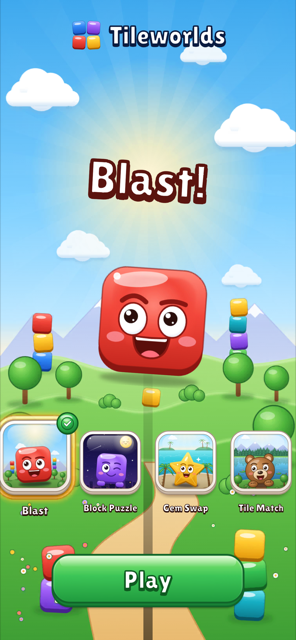
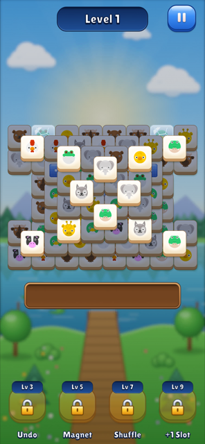
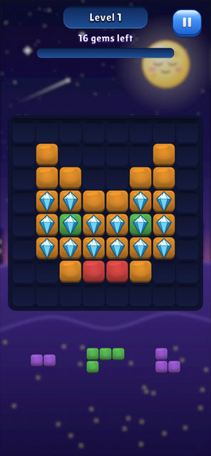
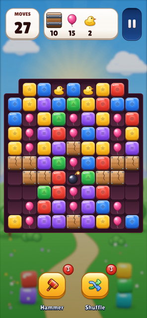
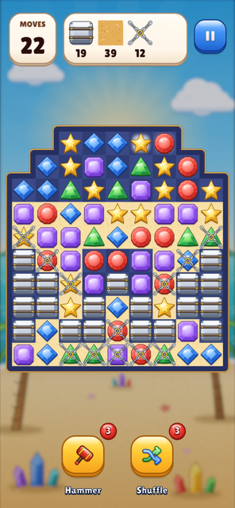
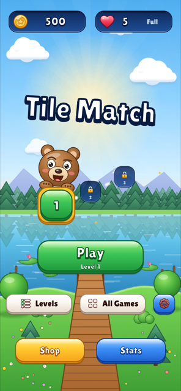
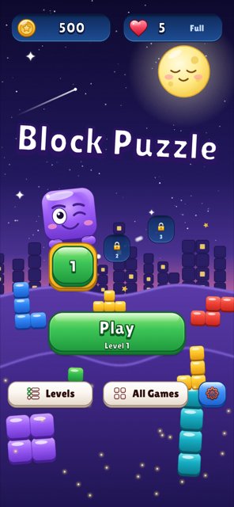
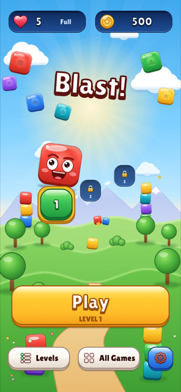
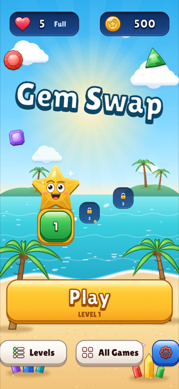

# Tileworlds

Four mobile puzzle games on one Unity 6.3 framework. I built it to show how I design and write puzzle-game code:
deterministic rules you can test without the engine, a view that never blocks input, generated levels with measured
difficulty, transactional saves, and architecture rules that are tests rather than wiki pages.

**Play it in a browser:** https://ocebi.github.io/tileworlds/ (portrait; works on a phone, progress is saved).

<p align="center">
  
  
  
  
  
</p>
<p align="center">
  
  
  
  
</p>

| Game | Genre | What's in it |
|---|---|---|
| **Tile Match** | Triple-tile match on a layered pile | 7-slot tray, frozen, hidden, linked and spawner tiles, undo, magnet, shuffle and extra-slot boosters, coin continues, shop, stats |
| **Block Puzzle** | Drag pieces onto an 8×8 board | 38 shapes in three tiers, a dealer that keeps one piece placeable, line clears, streaks, score and gem goals |
| **Blast** | Tap groups of same-coloured cubes | Rockets, bombs and disco balls that combo and chain, boxes, balloons, ducks, hammer and shuffle boosters |
| **Gem Swap** | Match-3 with swaps | Line, L, T and square specials, flyers, boxes and chains with diagonal slides, floors, dead-board shuffle, hints |

Every game ships 100 levels on a shared difficulty curve and shares one Home flow: level path, coins and lives,
continues, settings, loading screen and a hub that switches games without leaving Play mode. Blast and Gem Swap let
you keep playing while pieces are still falling.

## If you have ten minutes

Read in this order. Each file stands on its own.

1. **The rules engine.** `Assets/Tileworks/Tiles/Runtime/Model/Rules.cs` defines handlers, resolution systems and
   end conditions; `RuleEngine.cs` runs them: validate, apply, resolve until a pass changes nothing, evaluate, record.
2. **A game on it.** `Assets/Games/TileMatch/Model/TileMatchRules.cs` is the whole game as a list of systems. The
   `Systems/` folder holds the rules, `Modifiers/` the blockers, which plug in without touching the core
   (`OpenClosedModifierTests` proves it with a modifier that exists only in the test assembly).
3. **Events and the view.** `Tiles/Runtime/Model/BoardEvent.cs` is the one event struct every game emits, zero
   allocation, with typed read-only views. `Tiles/Runtime/View/EventPlayer.cs` plays them on per-entity lanes or in
   waves, so the rules run ahead and the animation catches up.
4. **Falls you can play through.** `Tiles/Runtime/Model/Gravity.cs` settles Blast and Gem Swap boards with diagonal
   slides; `Flight.cs` keeps pieces in flight as rules state, and the view reports landings as actions
   (ADR 0022, 0023).
5. **Solver and bots.** `Tiles/Runtime/Search/` holds the depth-first solver, Monte-Carlo playouts and the casual and
   skilled bot profiles that measure every level. `Assets/Games/TileMatch/Generation/KindAssigner.cs` builds a
   solution first and bakes kinds along it, so a Tile Match level is solvable by construction.
6. **The container.** `Assets/Tileworks/Kit/Runtime/Injection/` is an in-house DI container, about 800 lines:
   constructor injection, child scopes, lifecycles, collections, and validation that reports every missing
   registration and cycle before anything is created. `Assets/Games/Blast/Installer/BlastAppInstaller.cs` is a
   composition root.
7. **Saves.** `Assets/Tileworks/Kit/Runtime/Save/` is SQLite with DAOs, named transactions and per-module migrations.
   `Assets/Games/TileMatch/Service/LevelResultCommitter.cs` writes an attempt, its replay, progress, coins and lives
   in one transaction.
8. **The boundaries.** `Assets/Tests/Architecture/ArchitectureTests.cs` reads every assembly definition and fails on a
   wrong reference, an engine reference in a Model, a static mutable field, a scene search, a second public
   constructor or a file over 400 lines.
9. **The level tools.** `Assets/Tileworks/Tiles/Editor/LevelFileInspector.cs` turns any level file into a board you
   paint in the Inspector, with Measure and Play; `LevelSequenceWindow.cs` is the play-order window with a difficulty
   curve and publishing.

The full design is in [`ARCHITECTURE.md`](ARCHITECTURE.md); the reasons behind the choices are in [`docs/adr`](docs/adr).

## Content

Levels are generated and measured, never guessed. Planners choose mirrored shapes, blocker patterns and when each
mechanic appears; the generator sets moves, goals and blocker counts; bot playouts over several starting boards put
each level on its target win rate. Blast and Gem Swap tune against a skilled bot that builds specials and then report
the casual rate too (ADR 0024). Every level is a canonical JSON envelope with a content hash, the play order is a
separate file, and each game writes a report. Installed games can download newer levels from a published manifest.

## Tests

Run them from the Test Runner. About 940 EditMode test cases as of October 2026:

- **Rules:** ASCII board builders, random playouts with invariants checked after every action, replay determinism,
  golden replays of every shipped level, and allocation tests that prove a move allocates nothing after warm-up in
  Tile Match, Blast and Gem Swap.
- **Content:** every shipped level validates, is solvable or lands on its band, and the report matches.
- **Framework:** the container, composition of the real scopes with fake views, SQLite DAOs, savepoints, migrations,
  backup and restore, economy and lives maths, the trusted clock, the event player and the gravity loop, with board
  motion tests that step the tweens by hand and check that nothing jumps or starts early.
- **Architecture:** the rules in `ArchitectureTests.cs`.
- **PlayMode:** one flow test per game drives the real app on a throwaway save with a virtual mouse: Home, play level
  1 to a win, Next, Pause, Home.

## Running it

1. Open the project with **Unity 6000.3.26f1** (Unity 6.3 LTS). Packages come from the manifest; nothing else to
   install.
2. Press Play in `Assets/Games/Hub/Scenes/HubApp.unity` for the hub, or in any game's App, Home or Game scene; a
   scene boots its own app first.
3. Useful menus:

| Menu | What it does |
|---|---|
| `Tileworks/<Game>/Rebuild Scenes…` | Regenerates the game's scenes, prefabs and config assets from code |
| `Tileworks/<Game>/Generate Levels` | Runs the generator and bot measurement, writes levels, the sequence and `report.csv` |
| `Tileworks/Levels` | Play order per game with thumbnails and a difficulty curve; reorder, add, edit, publish |
| `Tileworks/Tile Match/Layout Editor` | Paints layered layouts and plays them straight away |
| `Tileworks/Time Travel/…` | Moves the running app's clock to test lives regeneration |
| `Tileworks/Build/…` | Builds a game or the whole showcase for Android or WebGL |

## Layout

```
Assets/Tileworks/      Kit, Tiles, Meta: the framework as source folders, each with Runtime, Editor and Tests
Assets/Games/<Game>/   Api · Model · Generation · Service · Controller · View · Installer · Editor · Tests
                       Config (generated assets) · Content (levels, sequence, report) · Art · Scenes (generated)
Assets/Games/Shared/   Scene and UI builders, shared art, audio and fonts, the game catalog
Assets/Tests/          Architecture tests
Assets/ThirdParty/     Third-party art, audio and fonts, one folder per vendor
Tools/                 Art and audio generators, layout writer, batch-mode runner, web deploy and level publishing
docs/                  ADRs, decisions log, level design and per-game design notes
```

## Credits

- Placeholder art, icons, sounds and fonts: [Kenney](https://kenney.nl), CC0.
- Music: MintoDog on OpenGameArt, CC0. Bomb sound: qubodup, CC0.
- Lilita One by Juan Montoreano, SIL OFL 1.1.
- The games' own pieces, backdrops, effects and UI kits are drawn by the scripts in `Tools/art`.
- Libraries: UniTask, PrimeTween, sqlite-net (gilzoide), Newtonsoft Json, Unity Input System, Addressables, URP.
